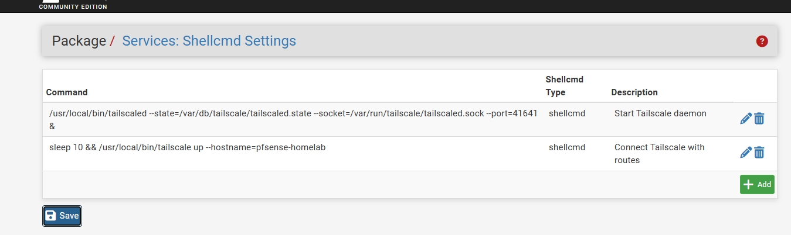
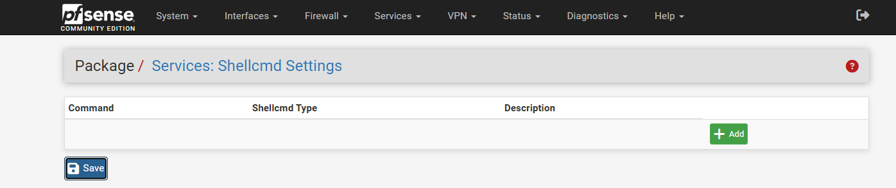
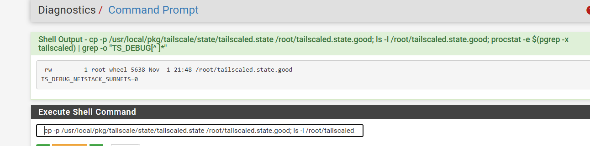
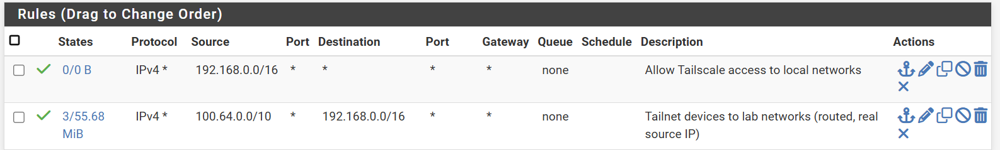
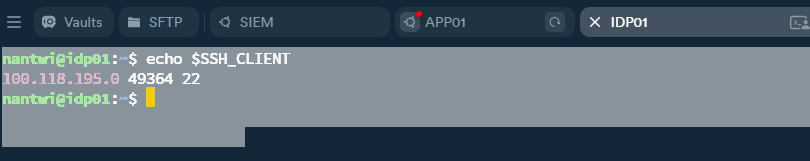
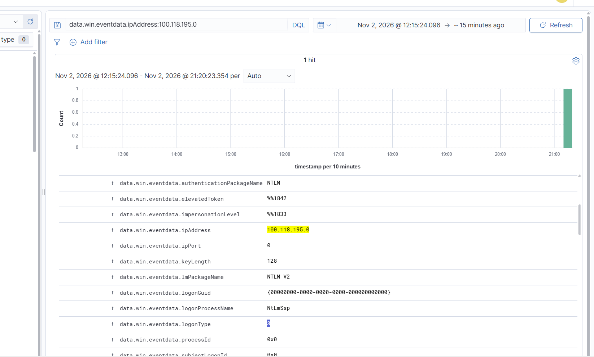
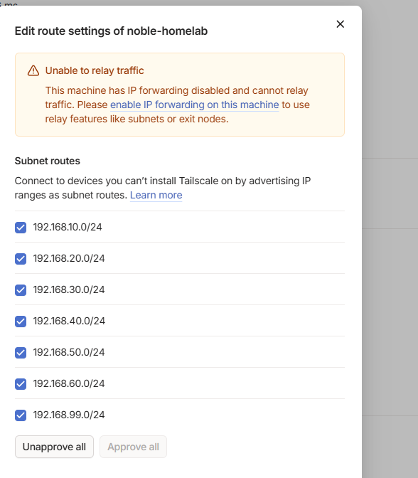
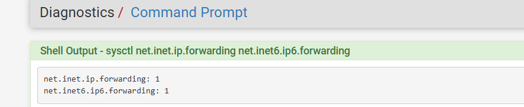
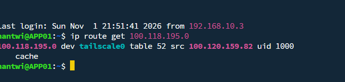

# 05. Remote access with Tailscale

**Purpose**: Records how the lab is reached from outside the house: a Tailscale mesh VPN with pfSense as the subnet router for every lab VLAN. The chapter covers why a mesh VPN was the only workable option behind a router the lab does not control, how it was first built by hand in July 2025, how it moved to the pfSense package, the November 2026 fault where two copies of Tailscale fought over one identity, and the change that made every remote connection arrive with the real device's address instead of the firewall's, proven in the SSH session itself and in a Wazuh logon event.

**Status**: Working and verified after a reboot (2 November 2026). Remote connections reach all lab VLANs and are logged with the connecting device's Tailscale address.

Related: `docs/01` (the VLANs being routed), `docs/11` (firewall rules), `docs/16` (Wazuh), `docs/23` (IDP01, whose logs showed the problem first).

---

## 1. The constraint

The lab sits behind a home router the lab does not administer. pfSense's WAN takes a private address from that router, so the lab is behind two layers of address translation and nothing on the internet can open a connection inward.

| Option | Needs inbound port forwarding | All VLANs | Decision |
|---|---|---|---|
| OpenVPN on pfSense | Yes | Yes | Not possible without control of the upstream router |
| ZeroTier | No | Limited on the free tier | Not enough routes |
| **Tailscale** | **No** (both ends dial out; relays when needed) | **Yes**, as subnet routes | **Chosen** |

Tailscale builds WireGuard tunnels between devices that each sign in to the same tailnet. pfSense joins as a **subnet router**: it advertises the lab's networks, and an approved device can reach them through it without any inbound port.

## 2. Design decisions

| Decision | Chosen | Why | What a larger estate does differently |
|---|---|---|---|
| Subnet router | **pfSense**, using the pfSense Tailscale package | Remote traffic enters through the firewall, so pfSense rules still decide what it reaches | Dedicated, highly available subnet routers, or Tailscale on each server |
| Routes advertised | The seven lab networks (`192.168.10.0/24` to `.60.0/24`, and `192.168.99.0/24`) | One router for the whole lab | Narrower routes per team or per role |
| Router accepts other routes | **No** | A router that only advertises has no use for other devices' routes, and accepting them risks routing loops | The same |
| Router key expiry | **Disabled** for the router only | A silently expired key would cut off all remote access | The same, with the router node tagged and owned by the team, not a person |
| Source address | **The real device address** (`100.64.0.0/10`), not the firewall's | Logs and rules can then name the device (section 6) | The same; it is the default on Linux subnet routers |

## 3. The first build (July 2025)

Tailscale was first installed on pfSense by hand: the FreeBSD `tailscale` package from the shell, the daemon started directly with its own `--state` and `--socket` paths when the service script would not start it, and `tailscale up` with the advertised routes. To survive reboots, two **Shellcmd** entries (pfSense's "run at startup" list) repeated those two commands at every boot.

It worked. When the pfSense **Tailscale package** was later installed to manage everything from the web interface, those two startup entries were not removed. Nothing failed for over a year, which is why the leftover went unnoticed (section 5).

## 4. The pfSense package

The package runs Tailscale through its own start script, `pfsense_tailscaled`, which calls the standard `tailscaled` service, keeps its identity in `/usr/local/pkg/tailscale/state`, brings the node up with the settings from **VPN > Tailscale > Settings**, and adds the tunnel interface to a `Tailscale` interface group so it has its own firewall rules tab. The advertised routes are listed in the same settings page and approved once in the Tailscale admin console.

## 5. Two copies of Tailscale (1 November 2026)

### 5.1 What was seen

After pfSense was upgraded from 2.8.0 to 2.9.0, the firewall came back logged out of Tailscale and had to be signed in again, joining as a new machine. The console screen showed Tailscale's log lines instead of the pfSense menu. After the first reboot following the repair, it was logged out again.

### 5.2 Why

```
ps axww -o pid,ppid,command | grep "[t]ailscaled"
```

showed a `tailscaled` started with `--state=/var/db/tailscale/...` and attached to the console, not the one the package starts (`-statedir /usr/local/pkg/tailscale/state`, under `daemon`). The 2025 Shellcmd entries were still in place:


*Figure 5.1: Services > Shellcmd. The two July 2025 entries: start `tailscaled` by hand, then `tailscale up` ten seconds later.*

At boot they started a second Tailscale **before** the package. The package's start script then saw a Tailscale already running and stepped aside. Worse, its routine for migrating an old identity copies `/var/db/tailscale/tailscaled.state` over its own whenever that file exists: the stray copy had just created an empty one there, so the real identity was overwritten. The upgrade did not cause the fault; it restarted everything and exposed it.

### 5.3 The fix


*Figure 5.2: Both entries deleted. `grep -c "tailscaled --state" /cf/conf/config.xml` then returned `0`.*

The firewall was signed in once more, a copy of the working identity was kept on the firewall (readable by root only), and the machine was rebooted to prove the result: one `tailscaled`, started by the package, with the same identity as before the reboot, and the console menu back.

**Lesson:** when a package takes over something that was set up by hand, retire the old start-up mechanism in the same change, and check that exactly one copy of the service is running.

## 6. Seeing the real device address

### 6.1 The problem



Before this change, every remote connection reached the lab **from the firewall** (`192.168.50.1` on the server VLAN). Keycloak's events, SSH logins and Windows logon events all showed the same address, so the laptop, the phone and any other tailnet device were indistinguishable. For a security lab that is a gap in attribution: an alert could say *a* remote device signed in, never *which*.

The cause is specific to FreeBSD. There, Tailscale handles subnet traffic in its own user-space network stack: it accepts the connection itself and opens a new one to the lab server from the firewall's address. On Linux the same router hands packets to the kernel and can keep the original source. The pfSense package has a setting for this, but it is disabled in its start script, because the `--snat-subnet-routes` flag it would use exists only on Linux.

### 6.2 The change

Tailscale reads an environment setting that turns its own network stack off for subnet traffic, so packets go to the pfSense kernel and are routed like any other traffic:

```sh
# /etc/rc.conf.d/tailscaled
tailscaled_env="TS_DEBUG_NETSTACK_SUBNETS=0"
```

`tailscaled_env` is the standard FreeBSD way to give a service extra environment variables. The file in `/etc/rc.conf.d/` is not managed by the package (its own settings live in `/usr/local/etc/rc.conf.d/`), so saving the package's settings does not remove it. After a restart through the package script, the running daemon carries the variable:


*Figure 5.3: `procstat -e` on the running `tailscaled` shows `TS_DEBUG_NETSTACK_SUBNETS=0`.*

Because the traffic is now routed rather than re-originated, pfSense's rules on the Tailscale interface see the real source. One rule allows the tailnet range to the lab networks; the older rule written for relabelled traffic carried nothing afterwards and was disabled:


*Figure 5.4: The rule for `100.64.0.0/10` (Tailscale's address range) to the lab networks carries the traffic; the earlier `192.168.0.0/16` rule shows 0 states and was disabled on 2 November 2026.*

### 6.3 The proof


*Figure 5.5: On IDP01, over the tunnel, `echo $SSH_CLIENT` shows `100.118.195.0`, the laptop's Tailscale address. The same command showed `192.168.50.1` before the change.*


*Figure 5.6: Wazuh, searching `data.win.eventdata.ipAddress:100.118.195.0`: a logon event from DC01 for a Remote Desktop session opened over Tailscale, with the laptop's address and its computer name. The logon used NTLM because the connection was opened by IP address; Kerberos needs the server's name. That difference is the subject of a later chapter.*

The trail is now complete: a Wazuh event gives a Tailscale address, the Tailscale admin console maps that address to a device and its owner. The same test was repeated after a reboot with the same result.

### 6.4 A warning that is wrong


*Figure 5.7: Since the change, the Tailscale admin console reports that the router has IP forwarding disabled.*


*Figure 5.8: pfSense itself says otherwise: IPv4 and IPv6 forwarding are both `1`. The routed connections in section 6.3 could not work otherwise. Tailscale's check does not read FreeBSD's settings; the warning is noted and ignored, and rechecked after Tailscale upgrades.*

### 6.5 Servers that run Tailscale themselves

One lab server, `APP01`, also runs Tailscale. Reached by its lab address, it stopped answering remote devices after the change, while every other server worked. The reason is the reply path:


*Figure 5.9: On APP01, the route to the laptop's address goes through APP01's own Tailscale interface (`tailscale0`), not back through pfSense.*

The request arrives through pfSense with a `100.x` source; APP01 recognises that range as Tailscale's and answers through its own tunnel; the laptop, expecting the answer from the subnet router, discards it. Before the change the firewall's address hid this. The rule that follows: **a server that runs Tailscale is reached by its own Tailscale name**, which is also a direct, end-to-end encrypted path. Servers without Tailscale are reached by their lab addresses as before.

## 7. Verification

| Test | Result |
|---|---|
| One `tailscaled`, started by the package, after a reboot | Yes, with the original identity |
| Environment setting present after a reboot | `TS_DEBUG_NETSTACK_SUBNETS=0` |
| SSH to IDP01 over the tunnel | `$SSH_CLIENT` = laptop's Tailscale address |
| Windows logon over the tunnel, in Wazuh | `ipAddress` = laptop's Tailscale address |
| pfSense web interface and lab VLANs over the tunnel | Reachable |
| APP01 by its Tailscale name | Reachable (by lab address: by design, see 6.5) |
| Old relabelled-traffic rule | 0 states, disabled |

## 8. What went wrong

| What happened | Cause | Lesson |
|---|---|---|
| Firewall logged out of Tailscale after an upgrade and again after a reboot | Startup entries from the manual 2025 install started a second Tailscale; the package's migration copied its empty identity over the real one | Retire the old mechanism when a package takes over; check for exactly one daemon |
| Console showed log lines instead of the menu | The stray daemon was attached to the console | Same fix |
| Pre-authentication key saved in the web interface was not applied | Not yet explained | Signed in with the interactive login link instead; open item |
| A server stopped answering by lab address | It runs Tailscale and replied through its own tunnel | Reach Tailscale-enabled servers by their Tailscale name |

## 9. Control mapping

| Control | How this chapter satisfies it |
|---|---|
| NIST SP 800-53 `AC-17` | Remote access through one managed, encrypted path, entering through the firewall's rule set |
| NIST SP 800-53 `AU-3` | Audit records now contain the true source of remote connections (the device's Tailscale address) instead of the firewall's |
| NIST SP 800-53 `AU-6` | Remote sign-ins can be traced from a Wazuh event to a specific enrolled device and its owner |
| NIST SP 800-53 `IA-3` | Device identification: each remote device has its own key and address in the tailnet |
| NIST SP 800-53 `SC-7` | Remote traffic is routed through pfSense and filtered by its rules on the Tailscale interface |
| NIST SP 800-53 `SC-8` | WireGuard encryption for all remote traffic |
| NIST SP 800-53 `CM-6`, `CM-7` | The startup configuration reduced to the one supported mechanism; an unused rule disabled |
| NIST SP 800-53 `CP-10` | Behaviour verified after a reboot, and a copy of the router's identity kept for recovery |
| CIS Controls v8 `12.7` | Remote devices connect through an authenticated, encrypted path to the managed network |
| CIS Controls v8 `8.5` | Detailed audit logs that include the source of each remote session |

## 10. Next steps

1. **Device-aware rules.** With real addresses arriving, firewall rules and Tailscale access policy can allow specific devices to specific services, instead of the tailnet as a whole.
2. **Tailscale and pfSense events into Wazuh**, so a remote session can be followed from tunnel to logon in one place.
3. **Kerberos by name.** Connecting to Windows servers by name, so remote administration uses Kerberos instead of NTLM, and detections for the difference.
