# 21. Find, fix, prove: closing the first finding

**Purpose**: Records the lab's first complete remediation loop. A credentialed scan found deprecated TLS versions offered by the Remote Desktop service on `WKS01`. A Group Policy change removed them. A third scan proved, from three independent angles, that they are gone. The chapter covers how the finding was chosen, how the fix was scoped and made reversible, how it was verified on the machine before any rescan, and what the rescan showed. Written so a reviewer can follow the evidence end to end without taking any step on trust.

**Status**: Complete for the finding it addresses. Remaining results from the same scans are triaged and tracked separately (section 3). Outstanding items in section 10.

Related: `docs/19` (the scanner, the scan identity and the first credentialed scan, whose section 8 asked for exactly this loop), `docs/20` (the Wazuh rules the same rescan put under load).

---

## 1. Why a loop, not a report

A single vulnerability report is a list. It says what was true at one moment, and nothing about whether anyone did anything about it. Vulnerability management is the loop around the list: scan, choose, fix, scan again, and show the finding closed. Chapter 19 ended with that loop as its first outstanding item.

The scan task was named `WKS01 credentialed baseline` for this reason. A baseline is only useful when something is compared against it.

## 2. Three scans of one machine

| | Scan 1 | Scan 2 | Scan 3 |
|---|---|---|---|
| Date (UTC) | 2026-09-13 | 2026-09-20 | 2026-09-29 |
| Signed in to the target | No | **Yes** | **Yes** |
| Highest severity | 5.0 Medium | 7.8 High | 7.8 High |
| High / Medium / Low | 0 / 2 / 1 | 1 / 3 / 1 | 1 / **2** / 1 |
| TLS 1.0 and 1.1 on RDP | found | found | **gone** |
| Results before filtering | 23 | 44 | 43 |

The first scan could not see inside the machine: its credential path was broken, and it reported four applications and no CVEs on a live Windows workstation, which is impossible. Chapter 19 fixed the path. The second scan signed in, and the picture changed. The third scan is the subject of this chapter.

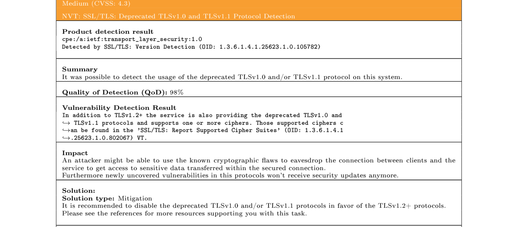
*Figure 21.1: Report two, port 3389. In addition to TLS 1.2 and later, the service also offers TLS 1.0 and TLS 1.1. Quality of detection 98%: the scanner completed handshakes with both old versions rather than inferring them.*

## 3. Choosing what to fix

The finding fixed here was **not** the highest scoring result on the report. That is deliberate.

A CVSS score describes how bad a weakness could be in general. Triage decides what it means on this machine. On inspection, several results above it on the report were raised by the mere presence of a file that ships with every Windows installation, with no fix the vendor will ever release, or by information the scanner chose to report cautiously. Those are recorded with a decision against each and are tracked with the rest of the lab's open work rather than published while they are open.

The deprecated TLS result was the right first fix because it was:

- **Real.** Confirmed by handshake, not by version inference.
- **This machine's own configuration.** Not a product defect waiting on a vendor.
- **Fixable by policy.** So the fix reaches every workstation, not one.
- **Provable.** A rescan can show the protocols gone, which is what makes the loop close.

## 4. What was wrong, in plain terms

When a client connects to Remote Desktop, the session is protected by TLS. The two ends negotiate, and agree on the highest version both support. TLS 1.0 and 1.1 carry known cryptographic weaknesses and are formally deprecated (RFC 8996). A modern client never needs them. Their only remaining use is to an attacker positioned between client and server, who can attempt to steer the negotiation down to the weakest version both sides will still accept.

Removing them from the server costs a modern client nothing, because the negotiation simply settles on TLS 1.2 as it already did.

## 5. Where Windows keeps the setting

TLS on Windows is provided by a component called SCHANNEL, and its protocol switches live in the registry:

```
HKLM\SYSTEM\CurrentControlSet\Control\SecurityProviders\SCHANNEL\Protocols\<version>\Server
```

The `Server` key governs the machine's role when others connect **to** it, which is the role the scanner tested on port 3389. Two values per version:

| Value | Set to | Meaning |
|---|---|---|
| `Enabled` | `0` | The protocol is switched off for this role |
| `DisabledByDefault` | `1` | It is not offered to software that does not explicitly ask for it |

Setting both is Microsoft's documented pattern. `Enabled = 0` does the work; `DisabledByDefault = 1` closes the path for software that requests "the defaults" rather than a named version.

## 6. The change, delivered by policy

### 6.1 A separate policy object

The change went into a new Group Policy object, `SEC-Workstation-TLS-Hardening`, not into the existing `SEC-Scanner-Access`. One policy, one purpose. If Remote Desktop ever misbehaves, this policy can be unlinked on its own without touching the scanner's access, and a reviewer reading the policy list can see what each one is for.

### 6.2 Scope confirmed before linking

The policy was first linked to `BIIRA/Computers`. That organisational unit contains both `Servers` and `Workstations`, so the change would have reached servers that were never assessed. Before moving the link, the target's actual location was read from the directory rather than assumed:

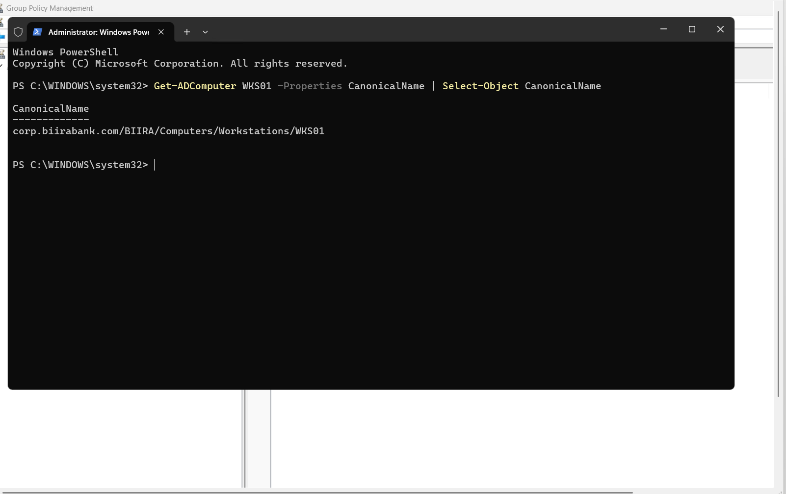
*Figure 21.2: `Get-ADComputer WKS01 -Properties CanonicalName` returns `corp.biirabank.com/BIIRA/Computers/Workstations/WKS01`. Moving a link to the wrong unit would have silently dropped the target out of scope.*

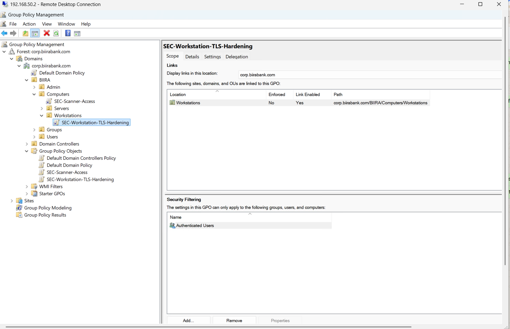
*Figure 21.3: One link, at `BIIRA/Computers/Workstations`. Servers and domain controllers are out of reach. A change is tested narrowly first and widened deliberately.*

### 6.3 Four registry items

The settings are delivered as Group Policy Preferences registry items under Computer Configuration, one per value.

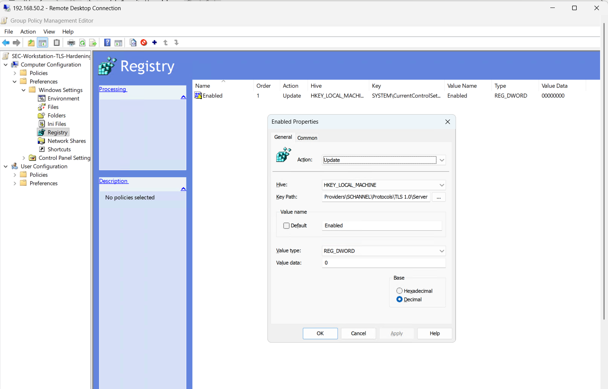
*Figure 21.4: `HKEY_LOCAL_MACHINE`, key `...\SCHANNEL\Protocols\TLS 1.0\Server`, value `Enabled`, type `REG_DWORD`, data `0`. The key does not exist on a default installation; the Update action creates it.*

### 6.4 Undo built into the change

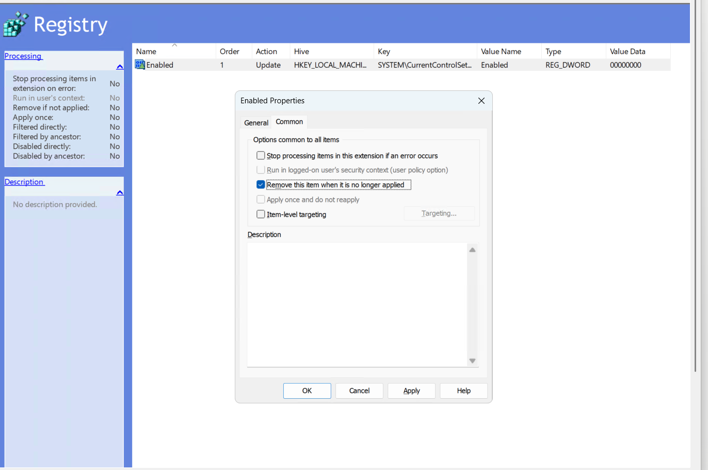
*Figure 21.5: The Common tab. With this option ticked, unlinking the policy removes the values from every machine it reached. Without it, preference items persist after the policy is gone, the same "tattooing" behaviour recorded for security settings in `docs/19`. A change without a clean way back is a change nobody can safely make.*

Ticking the option switches each item's action from Update to Replace, which is expected: the client now deletes and rewrites the value on every refresh, so it can also delete it cleanly when the policy stops applying.

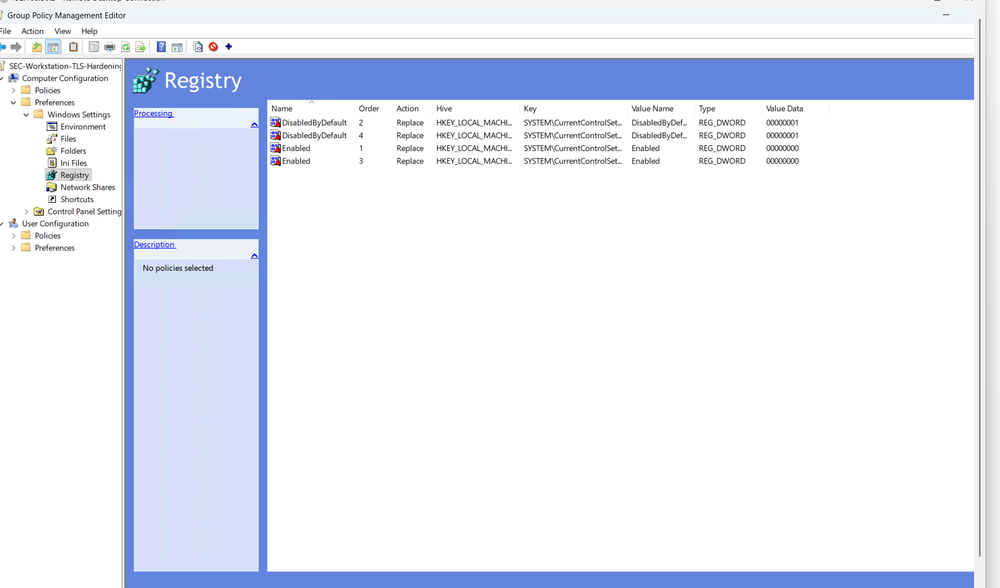
*Figure 21.6: `Enabled = 0` and `DisabledByDefault = 1` for both `TLS 1.0\Server` and `TLS 1.1\Server`, all four with action Replace.*

## 7. Proving it landed, before any rescan

A policy shown in the management console proves the policy exists. It does not prove a machine applied it. Each step below was checked on `WKS01` itself.

**The policy reached the machine.**

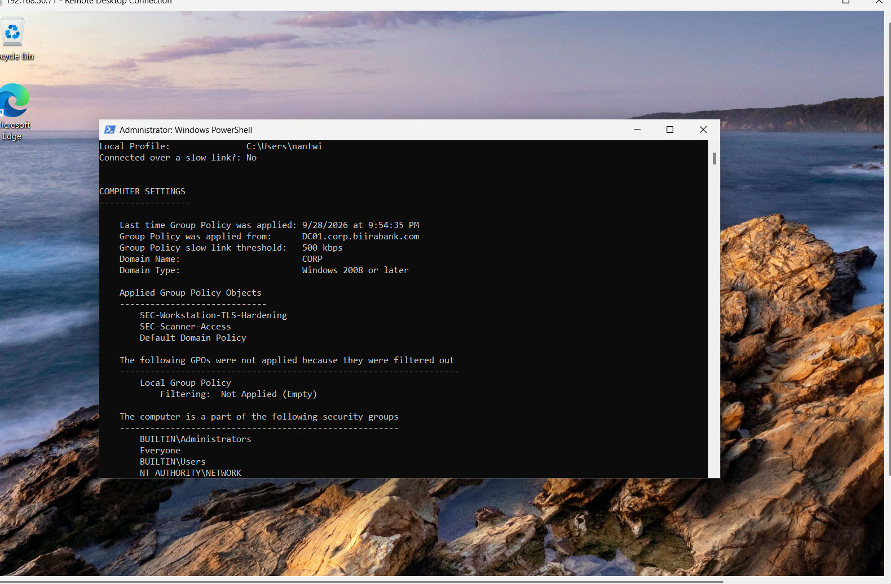
*Figure 21.7: `gpresult /r /scope computer` after `gpupdate /force`. Applied from `DC01.corp.biirabank.com` at 21:54 on 2026-09-28, `SEC-Workstation-TLS-Hardening` listed alongside `SEC-Scanner-Access`.*

**The values were written.**

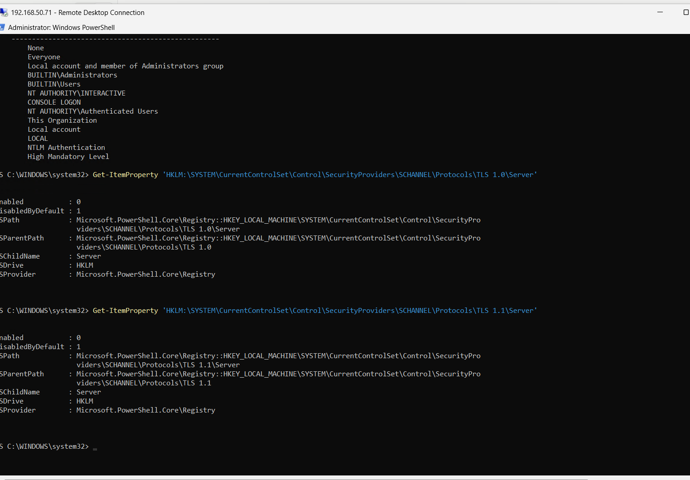
*Figure 21.8: `Get-ItemProperty` on both `Server` keys returns `Enabled : 0` and `DisabledByDefault : 1`. Written, but not yet in force.*

**Then a reboot.** SCHANNEL reads its protocol configuration at startup. Until the machine restarts, the values sit in the registry and the running service still offers the old versions. This is the in-between state that makes a "fixed" finding reappear on the next scan when the restart is skipped.

**Then the cheapest functional test.** The prediction before the reboot was that Remote Desktop would keep working, because the client and server would simply agree on TLS 1.2. After the restart the session reconnected without complaint. The fix did not break the service it hardened.

## 8. Proving it worked: the third scan

The `WKS01 credentialed baseline` task was run again. The target is configured by name, `wks01.corp.biirabank.com`, so it reached the workstation at its current DHCP address without any change to the scan configuration (`docs/19` 7.2).

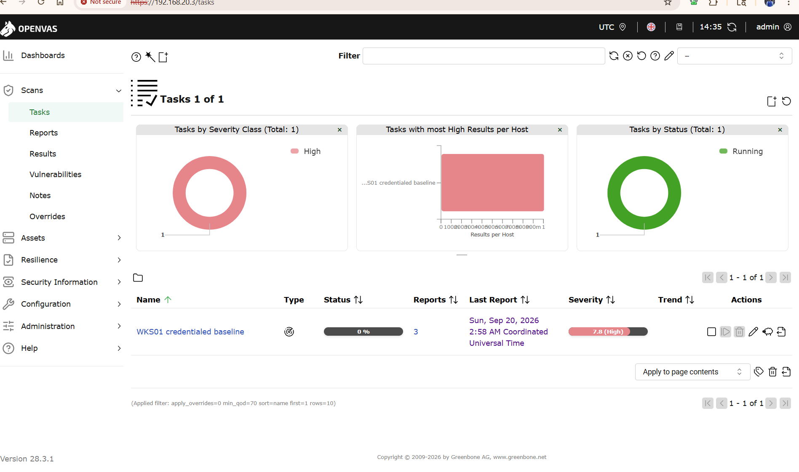
*Figure 21.9: The same task, its third report in progress. Same target, same credential, same configuration: the only intended difference between scan two and scan three is the policy.*

The result proves the change from three separate angles, which is stronger than any one of them:

1. **The finding is absent.** `SSL/TLS: Deprecated TLSv1.0 and TLSv1.1 Protocol Detection` no longer appears. Medium results fall from three to two, and every other result is unchanged, which is what a targeted fix should look like.
2. **The positive evidence.** The scanner's own protocol enumeration lists what the service now offers.
3. **An independent check agrees.** A separate test, of TLS renegotiation support, attempted a TLS 1.0 connection and recorded that it could not negotiate one.

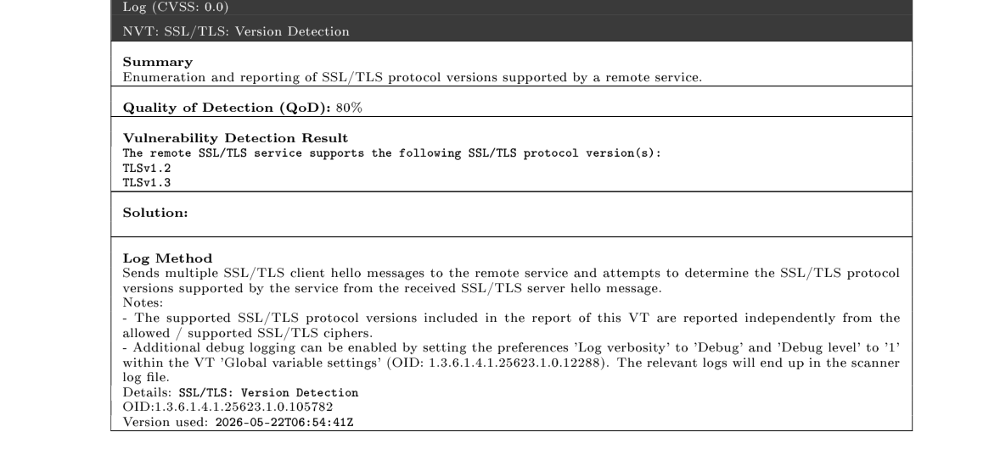
*Figure 21.10: `SSL/TLS: Version Detection` in report three. The service supports `TLSv1.2` and `TLSv1.3`. Nothing older.*

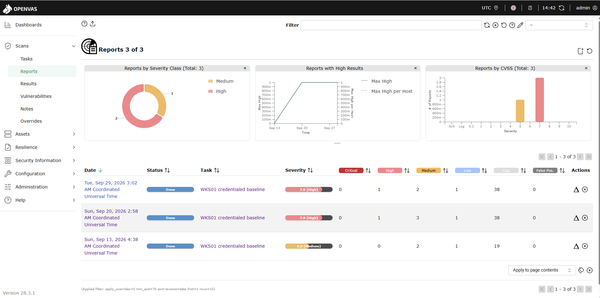
*Figure 21.11: The task's report history. 13 September, before the scanner could sign in. 20 September, signed in, deprecated TLS found. 29 September, the same findings minus one.*

Report three also confirms the scan identity still works after the change: host authentication over SMB on port 445 as `svc-greenbone`, **Success**.

## 9. What the same scan proved about the SIEM

The rescan doubled as the first real load test of the Wazuh rules written in `docs/20`. On the previous scan, rule 92652 raised 2,051 "possible pass-the-hash" alerts as the scanner signed in repeatedly. During this scan it raised none: rule 100020 recognised the scanner's account arriving from the scanner's address and kept it out of the alert queue, while the archive still recorded every sign-in. The remaining scanner noise is its logoffs, which are the next rule to write.

## 10. Outstanding

| Item | Detail | Control |
|---|---|---|
| Client-side TLS | Only the `Server` role was changed. `WKS01` can still offer TLS 1.0 and 1.1 when it connects out. The same four values under `...\Client` close that, after checking nothing in the estate still needs them | `SC-8`, `SC-13` |
| Widen the scope | The policy reaches `Workstations` only. Assess servers, then decide whether a server equivalent is safe to link | `CM-6` |
| Remaining results | Triaged, each with a decision. Tracked privately while open | `RA-5`, `RA-7` |
| DefectDojo | The rule set in `docs/19` was to wait for three reports and one closed finding. Both conditions are now met, so findings can be tracked from open to closed across scans rather than compared by hand | `RA-5`, `CA-7` |
| Kerberos over NTLM | The scan still authenticates with NTLM (`docs/19` 7.4) | `IA-2` |

## 11. Control mapping

| Control | How this chapter satisfies it |
|---|---|
| NIST SP 800-53 `RA-5` | Vulnerability monitoring and scanning, including the rescan that verifies remediation |
| NIST SP 800-53 `SI-2` | Flaw remediation: a specific finding identified, corrected, and the correction verified |
| NIST SP 800-53 `CM-6` | Configuration settings defined centrally by policy, not set by hand per machine |
| NIST SP 800-53 `CM-3` | A scoped, reversible change: narrow link, verified target, built-in removal |
| NIST SP 800-53 `SC-8`, `SC-13` | Transmission protection restricted to current TLS versions |
| CIS Controls v8 `7.1`, `7.2`, `7.7` | A vulnerability management process, a remediation process, and remediation of a detected vulnerability |
| CIS Controls v8 `3.10` | Encrypt sensitive data in transit, with deprecated protocols removed |
| PCI DSS v4.0 `11.3.1` | Internal scanning with rescans performed to confirm findings are resolved. The third scan is that rescan |

## 12. Lessons

**A finding is closed by evidence, not by a change.** Making the change was the smallest part of this chapter. Showing it reached the machine, took effect, did not break the service, and disappeared from an independent scan is the part that turns a fix into a closed finding.

**Severity ranks what could be bad. Triage decides what matters here.** The fix worth making first was not the highest-scoring result on the report.

**Settings written are not settings in force.** `gpresult` proves the policy arrived, the registry proves the values were written, and only a restart puts SCHANNEL settings into effect. Each step is a different claim and each needs its own check.

**Confirm scope from the directory, not from memory.** The first link would have reached servers. One command settled where the target actually lives.

**Build the way back into the change.** "Remove this item when it is no longer applied" turns unlinking into a real undo. Without it, the only safe change is one you never need to reverse.

**Test from more than one direction.** A missing finding could mean the check did not run. A missing finding, plus a positive list of supported versions, plus a separate test failing to negotiate the old one, cannot.
