# 22. CA01: a certificate authority, and LDAPS on the domain controller

**Purpose**: Records the build of `CA01`, the lab's enterprise certificate authority, and the first certificate it issued: the one that lets `DC01` answer directory queries over LDAPS. The chapter explains why the lab needed a CA at all, the design choices and what each one trades away, how the domain controller obtained its certificate without anyone touching a private key, and how the result was proven from inside the domain and from a machine that has never joined it. Written so a reader new to certificates can follow every step, and a reviewer can check every claim against its evidence.

**Status**: Complete for its purpose. LDAPS works and is in use (section 10). Scope and next steps in section 11.

Related: `docs/17` (the `corp.biirabank.com` forest this CA serves), `docs/12` (CA01 was Phase A of the expansion roadmap; this chapter pulls it forward), `docs/14` (the `<ROLE><NN>` naming and the backup design the snapshots here sit beside), `docs/11` (the domain controller's firewall access, where LDAPS consumers are added).

---

## 1. Why the lab needed a certificate authority

Applications that use Active Directory as their source of users sign in to it over LDAP. Two such consumers were waiting: an identity provider (Keycloak) that federates the directory, and an AI agent that looks up machines and accounts under its own service account (section 10). Both sign in with a password.

Plain LDAP on TCP 389 would send that password across VLANs where anything on the path could read it. LDAPS on TCP 636 wraps the same conversation in TLS. Before this chapter, port 636 on `DC01` accepted a connection and then reset the handshake: a domain controller only offers LDAPS once it holds a suitable certificate, and it had none.

A certificate has to be issued by someone the clients trust. That is the job of a certificate authority, so the lab needed one.

## 2. Certificates in four ideas

1. **A key pair.** A private key that never leaves its owner, and a public key that can be shared with anyone. What one key locks, only the other opens.
2. **A signature.** The owner runs a fingerprint of a document through the private key. Anyone holding the public key can check that the document is unchanged and that only the owner could have signed it.
3. **A certificate.** A small document that says "this public key belongs to `DC01.corp.biirabank.com`", signed by a certificate authority. It is an ID card, and the CA's signature is the seal on it.
4. **A chain of trust.** A client trusts a certificate when it can follow the seals up to a root it already trusts. A root signs its own certificate, so trusting a root is a decision made in advance, by putting its certificate in a trusted store.

Everything below is one of these four ideas being put to work.

## 3. Design decisions

Windows offers two independent choices when a CA is created:

| | **Root** (signs itself) | **Subordinate** (authority from a root above it) |
|---|---|---|
| **Enterprise** (integrated with AD: templates, auto-enrolment) | **CA01** | The usual corporate issuing CA |
| **Standalone** (no AD, requests approved by hand) | The usual offline root | Rare |

| Decision | Chosen | Why | What a larger estate does differently |
|---|---|---|---|
| CA type | **Enterprise Root** | Integrates with the directory, so domain machines can enrol themselves through templates and auto-enrolment, which is what lets `DC01` get its certificate with no manual request (section 7) | Two tiers: an offline standalone root signs one enterprise subordinate, which does the daily issuing. The root stays powered off between uses, so it can never be reached from the network |
| Key | **RSA 4096, SHA-256** | A long-lived root is worth a key size that will outlast it | The same |
| Key storage | **Microsoft Software Key Storage Provider** | No hardware required | A hardware security module, so the root key cannot be copied off the machine at all |
| Validity | **10 years** for the root; issued certificates 1 year | A root outlives what it signs. Short-lived leaf certificates renew automatically | The same pattern |
| Placement | **VLAN 50 (EnterpriseLAN), `192.168.50.3`**, beside `DC01` | No firewall rule is needed between the CA and the domain controller it serves | The same: a CA lives with the identity tier it serves |
| Edition | **Windows Server 2025 Standard, Desktop Experience** | The certificate consoles (`certsrv`, `certtmpl`, `certlm`) are used for learning alongside the commands | Server Core, managed remotely, for a smaller attack surface |
| Name | **`CA01`**, CA name **`Biira Bank Root CA`** | Follows the `<ROLE><NN>` convention (`docs/14`) | The same |

A CA is a Tier 0 asset: whoever controls it can mint a certificate the whole domain accepts. It sits in the same trust tier as the domain controller, and is treated that way.

## 4. Building the machine

### 4.1 The virtual machine

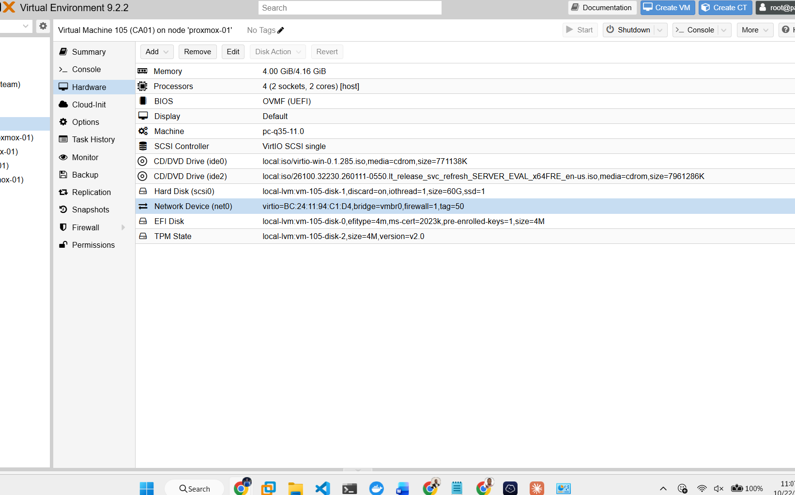
*Figure 22.1: VM 105 (`CA01`) on `proxmox-01`. 4 vCPUs (`host` CPU type), 4 GiB, UEFI (OVMF) on the `q35` machine type, a 60 GiB VirtIO SCSI disk with discard and IO thread, an EFI disk and a TPM 2.0 state, and the network device on `vmbr0` with **`tag=50`**.*

The VLAN tag is the single setting that decides which network a guest lives on (`docs/10`). It was first entered as `6`, and was caught and corrected to `50` in a review of the hardware list before Windows was ever installed. Reading the hardware tab before first boot costs a minute; a wrong tag found after the domain join costs a rebuild.

### 4.2 Network, then the domain

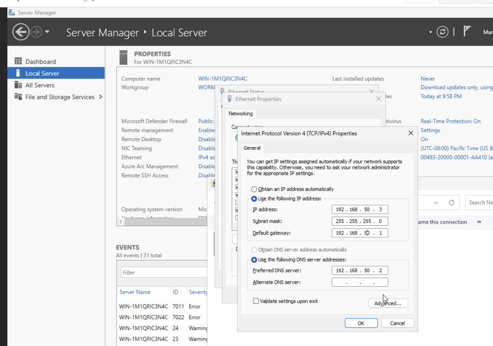
*Figure 22.2: A static address, `192.168.50.3/24`, gateway `192.168.50.1` (the EnterpriseLAN interface on pfSense), and DNS `192.168.50.2`, which is `DC01`. A domain member must use the domain controller for DNS, or it cannot find the domain to join it. The machine still carries its installer name here; it took the name `CA01` when it joined the domain.*

The gateway was first typed as the Management VLAN's `192.168.10.1` and corrected before saving. Name resolution was then tested against both the internal zone and a deliberate typo: `corp.biirabank.com` resolved to `192.168.50.2`, while a misspelt name was forwarded out and answered by public DNS. That is the forwarder doing its job, and a reminder to read the answer, not just look for one.

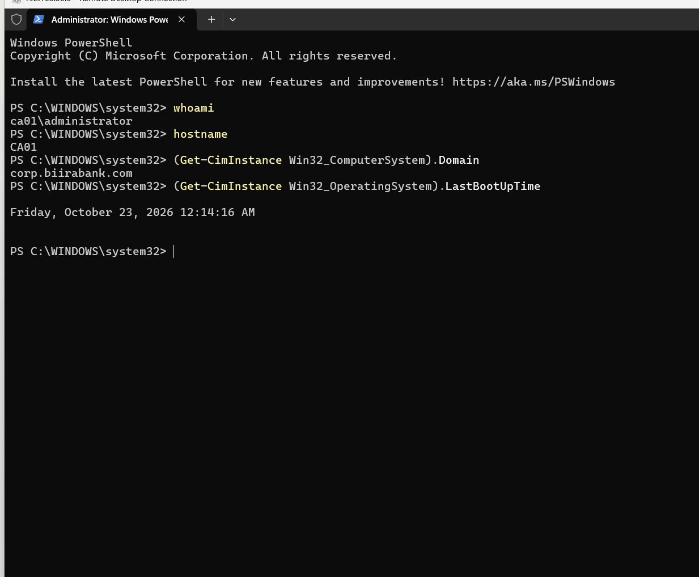
*Figure 22.3: After the join and restart: `hostname` is `CA01`, and the machine's domain is `corp.biirabank.com`. The session shown is still the local administrator; the CA itself was installed as a domain account in the Enterprise Admins group (figure 22.5).*

After joining, `CA01` was moved from the default `Computers` container into `BIIRA\Computers\Servers`, where server Group Policy applies.

### 4.3 Restore points around the change

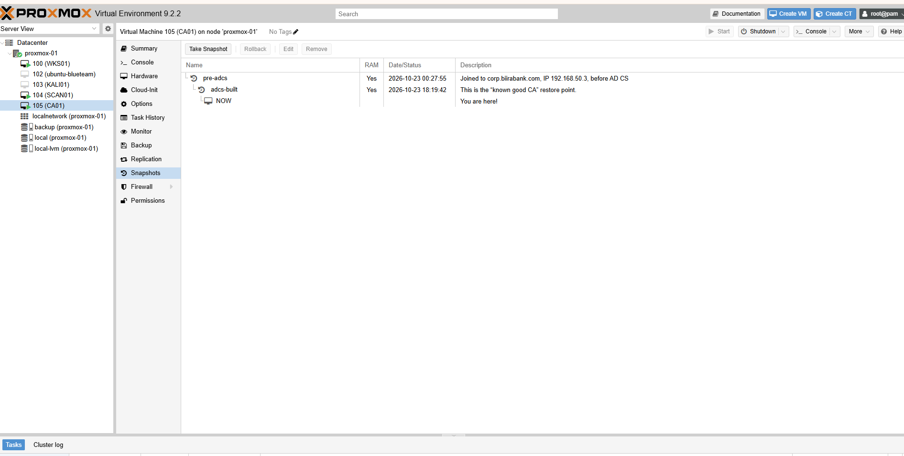
*Figure 22.4: Two snapshots bracket the change. `pre-adcs`, taken once the machine was joined and addressed but before the CA existed, and `adcs-built`, the known-good CA. Either side of the change can be returned to in seconds.*

A snapshot is not a backup (`docs/14` covers those). It is a restore point for one change on one machine, and it is what makes trying the change safe.

## 5. Installing the certificate authority

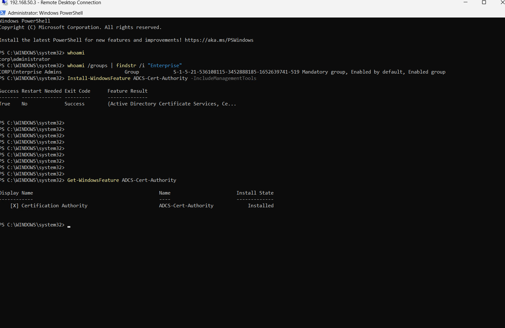
*Figure 22.5: Signed in over Remote Desktop as `corp\administrator`, a member of `CORP\Enterprise Admins` (SID ending `-519`). `Install-WindowsFeature ADCS-Cert-Authority -IncludeManagementTools` succeeds with no restart needed, and `Get-WindowsFeature` shows the Certification Authority role service installed.*

Only the **Certification Authority** role service was installed. The web enrolment pages and other role services add listening services that nothing here needs.

An enterprise CA writes itself into the forest's configuration, which is why its setup requires Enterprise Admins. Installing the role only adds the software; configuring it creates the CA:

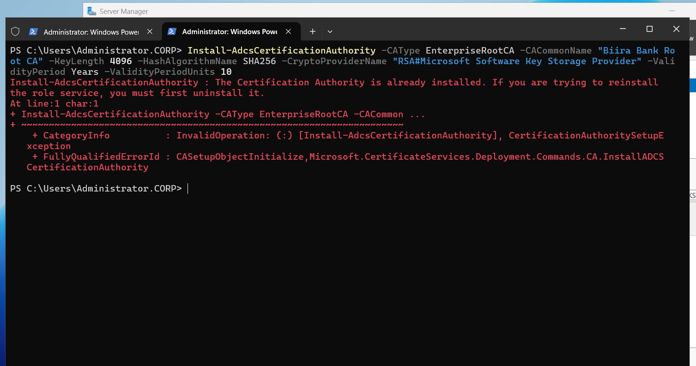
*Figure 22.6: `Install-AdcsCertificationAuthority -CAType EnterpriseRootCA -CACommonName "Biira Bank Root CA" -KeyLength 4096 -HashAlgorithmName SHA256 -CryptoProviderName "RSA#Microsoft Software Key Storage Provider" -ValidityPeriod Years -ValidityPeriodUnits 10`. Captured on a second run, which is why it reports that the CA is already installed: the parameters are the record, and the error confirms the CA exists.*

Each parameter is one page of Server Manager's "Configure AD CS" wizard: setup type and CA type, the cryptography page, the CA name, and the validity period. The command is the wizard written down, so it can be reviewed, repeated and kept in version control.

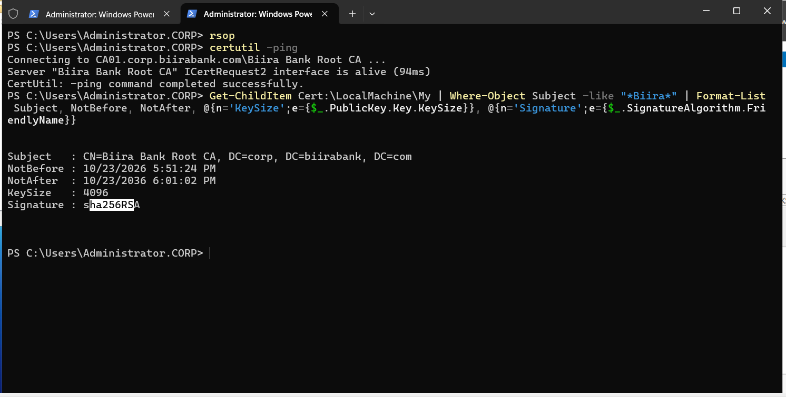
*Figure 22.7: `certutil -ping` reaches `CA01.corp.biirabank.com\Biira Bank Root CA` and reports its request interface alive. The root certificate: subject `CN=Biira Bank Root CA, DC=corp, DC=biirabank, DC=com`, valid from 23 October 2026 17:51 to 23 October 2036 18:01, a 4096-bit key, signed with `sha256RSA`.*

The CA was created at about 18:01, which the end date preserves ten years on, yet the certificate is valid from 17:51. Windows back-dates a new certificate's start by ten minutes, so that machines whose clocks run slightly behind still accept it.

## 6. What the CA changed in the directory

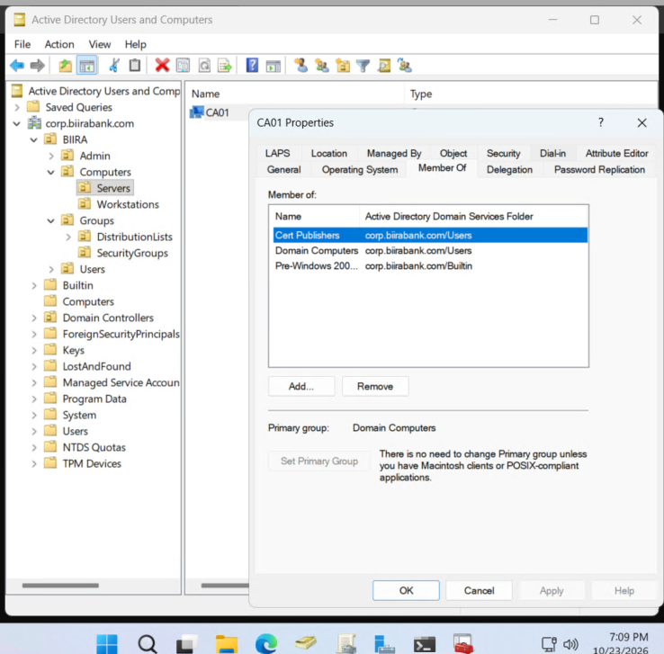
*Figure 22.8: `CA01` in `BIIRA\Computers\Servers`, a member of `Cert Publishers`, `Domain Computers` and `Pre-Windows 2000 Compatible Access`.*

The setup added the CA's own computer account to two built-in groups:

- **`Cert Publishers`** (SID ending `-517`, present in every domain since it was created). Members may publish certificates onto user and computer objects, so others can look them up.
- **`Pre-Windows 2000 Compatible Access`**, so the CA can read a requester's group memberships when it decides who may enrol.

Both memberships are expected and required. Membership of `Cert Publishers` is also a quiet but real power, so a new member of that group is an event worth an alert (group change events 4728 and 4732).

## 7. How DC01 got its certificate

Nobody requested a certificate for `DC01` by hand, and no private key was copied anywhere. Two commands on `DC01` set the process off:

1. **`gpupdate /force`.** The domain controller refreshed its policy and read what the new CA had published to the directory. `Biira Bank Root CA` arrived in its Trusted Root Certification Authorities store: `DC01` now recognises `CA01`'s seal.
2. **`certutil -pulse`.** Auto-enrolment ran immediately instead of at its next scheduled check. `DC01` found a template it is allowed to enrol for, **generated its own key pair locally**, and sent `CA01` a request: its name and its public key, asking for a signature. `CA01` checked the template's permissions, signed, and returned the certificate, which `DC01` stored beside its private key.

**The private key was created on `DC01` and has never left it. `CA01` never saw it.** That is what a certificate request is for: the CA vouches for a public key without ever holding the secret half.

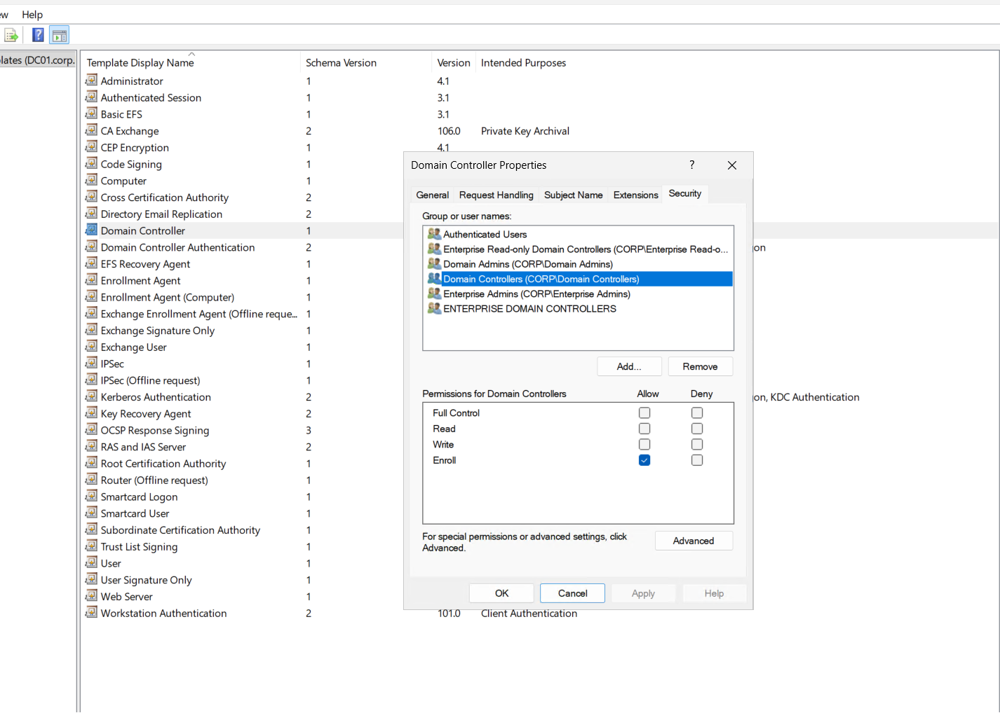
*Figure 22.9: The `Domain Controller` certificate template, Security tab. `CORP\Domain Controllers` holds Enroll. Template permissions are the CA's access control: they decide who may obtain which kind of certificate.*

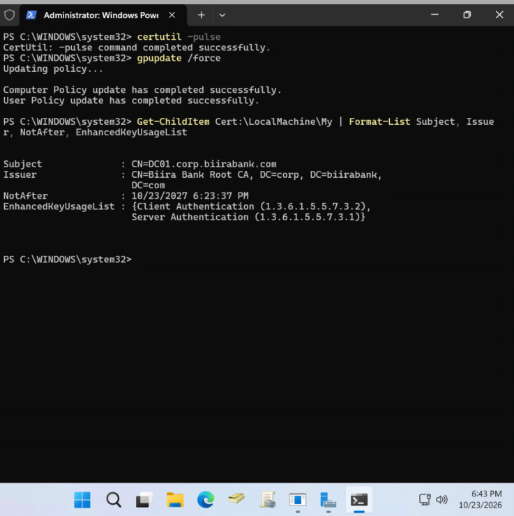
*Figure 22.10: On `DC01`, `certutil -pulse` and `gpupdate /force` complete, then the machine's own store holds one certificate: subject `CN=DC01.corp.biirabank.com`, issuer `CN=Biira Bank Root CA`, valid until 23 October 2027, with Client Authentication (`1.3.6.1.5.5.7.3.2`) and Server Authentication (`1.3.6.1.5.5.7.3.1`). Server Authentication is the purpose LDAPS needs. The numbers are the worldwide identifiers for those purposes.*

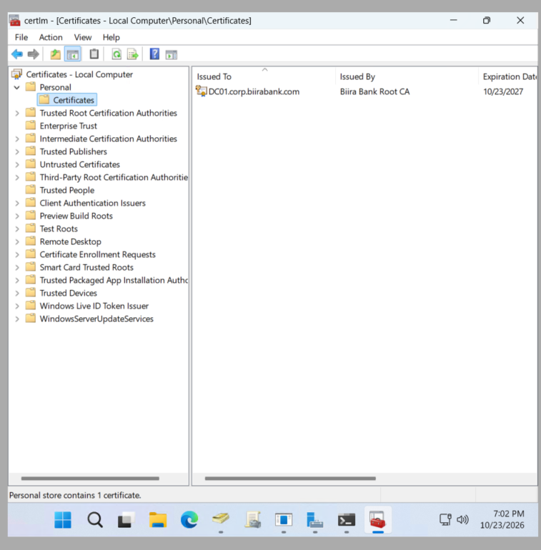
*Figure 22.11: The same certificate in the Local Computer certificate console: issued to `DC01.corp.biirabank.com` by `Biira Bank Root CA`, expiring 23 October 2027, the only certificate in the Personal store.*

No restart and no LDAP configuration were needed. The directory service looks for a suitable certificate by itself and starts offering TLS on 636 once it finds one.

## 8. LDAPS proven on the domain controller

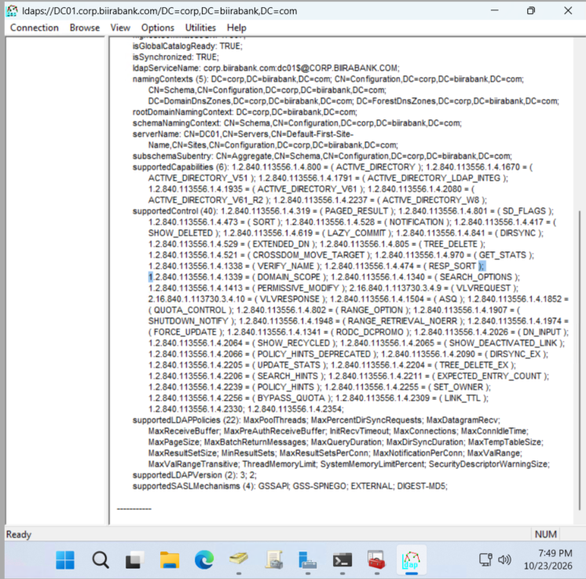
*Figure 22.12: `ldp.exe` on `DC01`, connected to `ldaps://DC01.corp.biirabank.com` on port 636 with SSL, returning the directory's root entry: naming contexts, supported controls, `supportedLDAPVersion` 3 and 2, and the supported SASL mechanisms. Before this chapter the same connection was reset at the handshake.*

The connection is made by **name**. A certificate is issued to a name, and a client compares the name it dialled with the name on the certificate; dialling the IP address would fail that check (section 9).

## 9. Trust from outside the domain

Domain members trust the root because Group Policy put it in their stores. A machine that has never joined the domain, such as an application server or an admin laptop, has to be given the root certificate deliberately, and should check it has been given the right one.

### 9.1 Export the root, and fingerprint it

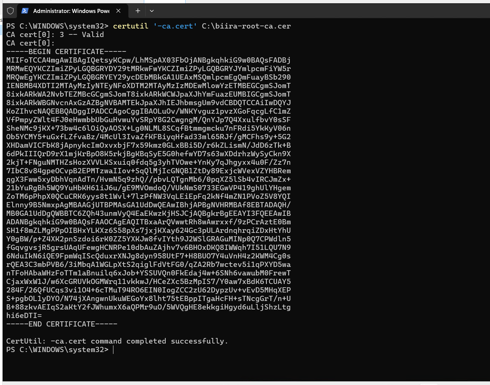
*Figure 22.13: On `CA01`, `certutil '-ca.cert' C:\biira-root-ca.cer` writes the root certificate to a file. The verb is quoted because PowerShell otherwise splits `-ca.cert` into two arguments. On a machine that is not the CA, the same command needs `-config` to say which CA to ask. This file is the public certificate only. The CA's private key is never exported.*

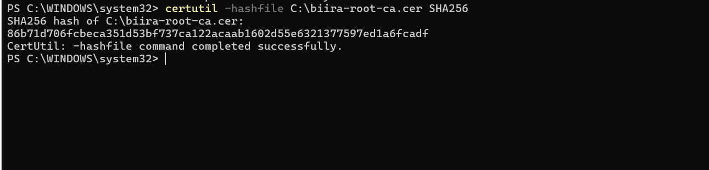
*Figure 22.14: `certutil -hashfile C:\biira-root-ca.cer SHA256`.*

The fingerprint of the lab's root certificate is:

```
86b71d706fcbeca351d53bf737ca122acaab1602d55e6321377597ed1a6fcadf
```

It is published here on purpose. Anyone who copies the root to a new machine computes the same hash there (`sha256sum` on Linux and Git Bash) and compares. A match proves the file is the real root and not one substituted on the way. Trusting a root is the most powerful trust decision a machine makes, so it is never made on a file that has not been checked.

The file `certutil` writes is in DER (binary) form. Tools such as OpenSSL and Python expect PEM (Base64 text), so it was converted once on the laptop:

```bash
openssl x509 -inform der -in biira-root-ca.cer -out biira-root-ca.pem
```

### 9.2 Verified, and unverified

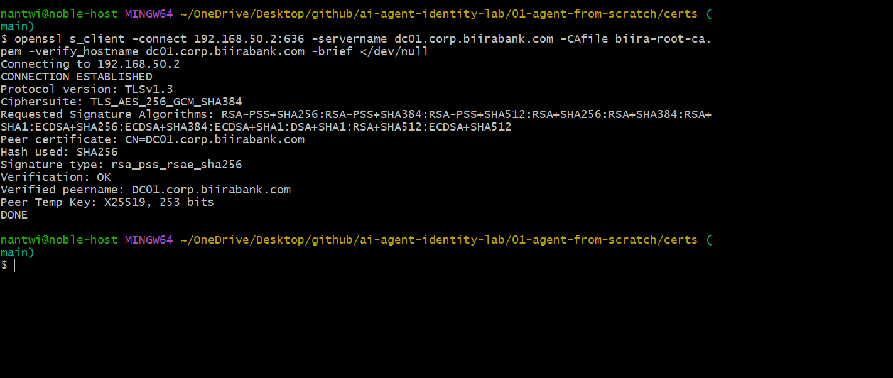
*Figure 22.15: From the admin laptop, over Tailscale: `openssl s_client -connect 192.168.50.2:636 -servername dc01.corp.biirabank.com -CAfile biira-root-ca.pem -verify_hostname dc01.corp.biirabank.com -brief`. TLS 1.3, `TLS_AES_256_GCM_SHA384`, peer `CN=DC01.corp.biirabank.com`, **`Verification: OK`**, **`Verified peername: DC01.corp.biirabank.com`**, key exchange `X25519`, which gives forward secrecy.*

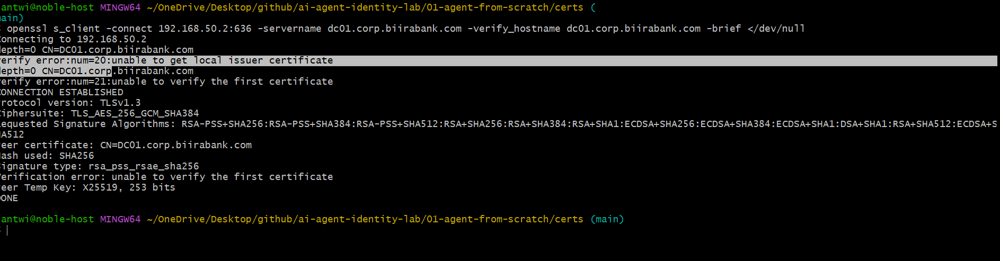
*Figure 22.16: The same command without `-CAfile`. Error 20, "unable to get local issuer certificate": the laptop does not know `Biira Bank Root CA`, so it cannot check the seal. Error 21, "unable to verify the first certificate", follows from it. The connection still opens, because `s_client` is a diagnostic tool that reports and carries on.*

The pair is the clearest evidence in the chapter. A real client, such as Python's `ssl` module, Keycloak or a browser, **stops** at error 20. That matters because the encrypted channel in figure 22.16 still has no proven far end: anyone able to sit between the laptop and `DC01` could present their own certificate, and the laptop would be encrypting its password straight to them. **Encryption without verification protects against eavesdroppers, not impostors.** Verification is what figure 22.15 adds, and it rests on the fingerprint check in 9.1.

## 10. What uses it now

The first consumer is an AI agent that answers questions about this lab. It signs in to `DC01` over LDAPS as its own read-only service account, verifies the certificate against this root by name, and reads a fixed list of attributes, so it can tell, for example, that an address in an alert belongs to the lab's own vulnerability scanner. The build, with its evidence, is project 1 of the public [`ai-agent-identity-lab`](https://github.com/noble-antwi/ai-agent-identity-lab/tree/main/01-agent-from-scratch) repository.

The next is the lab's identity provider, which federates the directory read-only over the same channel.

## 11. Scope and next steps

**Scope.** One certificate has been issued: `DC01`'s. The CA issues nothing else yet, and its other templates are left unpublished until a consumer needs them.

**Next.**

- **Monitoring the CA.** `CA01` joins the SIEM with a Wazuh agent and Sysmon, so issuance and changes to the CA are recorded centrally.
- **Firewall access for consumers.** Each LDAPS consumer outside VLAN 50 is given TCP 636 to the domain controller only, recorded in `docs/11` as it arrives.
- **The identity provider** federates the directory over LDAPS.

Open weaknesses and gaps in detection are not listed here. They are tracked in a private backlog until fixed, and are then written up publicly with their evidence.

## 12. Control mapping

| Control | How this chapter satisfies it |
|---|---|
| NIST SP 800-53 `SC-12` | Cryptographic keys established and managed: the root key generated on the CA, each machine's key generated on that machine |
| NIST SP 800-53 `SC-17` | Public key infrastructure certificates issued under the organisation's own CA and policy |
| NIST SP 800-53 `SC-8`, `SC-13` | Directory traffic carrying credentials protected by TLS 1.3 |
| NIST SP 800-53 `SC-23` | Session authenticity: the client verifies the server's certificate and name before trusting the session |
| NIST SP 800-53 `IA-5(2)` | Public key-based authentication: certificate validation to a trusted root, and trust anchors distributed and checked by fingerprint |
| NIST SP 800-53 `AC-3` | Enrolment controlled by certificate template permissions |
| NIST SP 800-53 `CM-3` | A controlled change, bracketed by restore points |
| CIS Controls v8 `3.10` | Encrypt sensitive data in transit |
| PCI DSS v4.0 `4.2.1.1` | An inventory of the trusted keys and certificates in use: the root and its published fingerprint (section 9.1), and the one certificate issued from it |

## 13. Lessons

**A certificate is issued to a name.** `DC01`'s certificate names `DC01.corp.biirabank.com`, so clients must dial that name. The address works for the network and fails the identity check.

**Encryption without verification protects against eavesdroppers, not impostors.** Figures 22.15 and 22.16 are the same encrypted connection. Only one of them knows who is at the other end.

**The private key never travels.** `DC01` made its own key pair and sent only the public half. A design in which a CA, an admin or a script handles another machine's private key is already weaker than this one.

**Trust a root only after checking it.** The root is the one file that, if substituted, makes every later check meaningless. Its fingerprint is published here so the check is always possible.

**Read the hardware before the first boot.** A one-digit VLAN tag decided which network the CA would live on. It was caught in review, not after the domain join.

**Make the change safe to try.** Two snapshots, before and after, turned a new Tier 0 service into something that could be undone in seconds.
