# 23. IDP01: an identity provider, Keycloak, federated to Active Directory

**Purpose**: Records the build of `IDP01`, the lab's identity provider: an Ubuntu server running Keycloak, which lets applications send people to one place to sign in while Active Directory stays the only place accounts and passwords live. The chapter covers why the lab needed it and why it sits in the identity tier, the hardening of the machine itself, the HTTPS certificate it obtained from `CA01` without its private key ever leaving it, Keycloak and its database in Docker Compose, the first administrator and the removal of the bootstrap one, and the read-only LDAPS connection to `DC01` proven by a Biira Bank employee signing in with her directory password. Written so a reader new to identity providers can follow every step, and a reviewer can check every claim against its evidence.

**Status**: Steps 1 to 5 complete: the machine, its hardening, its certificate, Keycloak, and Active Directory federation all work and are proven below. Step 6, the first machine client (the AI agent signing in with client credentials), is next (section 13).

Related: `docs/22` (the certificate authority that issued IDP01's certificate, and LDAPS on `DC01`), `docs/17` (the `corp.biirabank.com` forest Keycloak reads), `docs/14` (the `<ROLE><NN>` naming), `docs/11` (the domain controller's firewall access), `docs/ssh-configuration` (the lab's SSH conventions).

---

## 1. Why the lab needed an identity provider

Every application that keeps its own user list adds another place to create, disable and audit accounts, and another password for people to reuse. An identity provider (IdP) removes that: applications hand sign-in to the IdP, the IdP checks the person, and the application receives a signed statement of who they are. Disable someone once and they are out of everything behind it.

Biira Bank already has a source of truth for people: Active Directory on `DC01`. Keycloak is placed in front of it. It never stores AD passwords: when someone signs in, Keycloak finds them in the directory with its own read-only service account and then asks AD to check *their* password.

The IdP is a Tier 0 system. Whoever controls it can sign in as anyone behind it. It therefore sits on VLAN 50 (EnterpriseLAN) with `DC01` and `CA01`, the same trust tier as the systems it depends on, and is built and hardened with that in mind.

## 2. Design decisions

| Decision | Chosen | Why | What a larger estate does differently |
|---|---|---|---|
| Product | **Keycloak 26.8.1** | Open source, standards-based (OpenID Connect, SAML), federates AD over LDAPS, and is what many enterprises run for internal applications | The same, or a commercial IdP (Okta, Entra ID) for workforce SaaS, with Keycloak for internal and machine identity |
| Placement | **VLAN 50, `192.168.50.4`**, beside DC01 and CA01 | Tier 0 lives together; LDAPS to DC01 needs no cross-VLAN rule | A dedicated identity segment, reached by applications only through a reverse proxy |
| Platform | **Ubuntu 26.04 VM (Proxmox VM 106)**, 2 vCPU (`host` type), 4 GiB, 32 GiB on `local-lvm` | Lightweight, LTS, and the same base as `SCAN01` | The same, in a highly available pair behind a load balancer |
| Packaging | **Docker Compose**, Keycloak plus **PostgreSQL 18.6**, exact versions pinned | One file rebuilds the whole service; a rebuild next month gives the same software | Kubernetes with the Keycloak Operator, and a managed database |
| Database exposure | **No published port** | Only Keycloak, on a private container network, can reach PostgreSQL | The same, plus network policies |
| Transport | **HTTPS only**, plain HTTP disabled, certificate from `CA01` | Passwords are typed into this service | The same, often terminated at a proxy with mutual TLS behind it |
| Directory connection | **LDAPS, read-only**, dedicated service account, **Employees OU only** | Least privilege: the IdP can read people, never change them, and administrators and service accounts cannot sign in through it | The same; write-back for self-service password reset only with tight delegation and monitoring |
| Staff realm | **`biira`**, separate from `master` | `master` is only for those who run Keycloak; a mistake in a staff setting cannot reach the keys to the system | The same |

## 3. The machine

### 3.1 The virtual machine

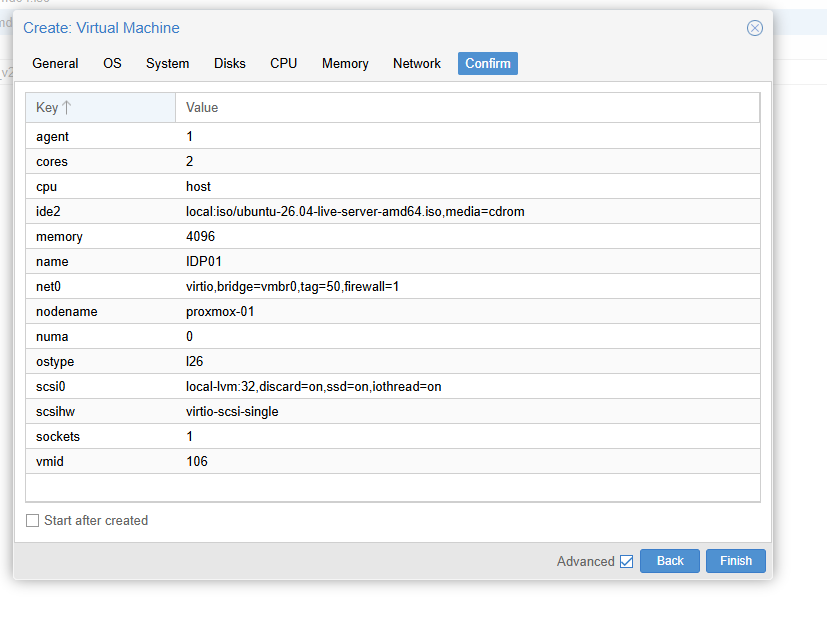
*Figure 23.1: The Proxmox confirm page for VM 106: `host` CPU type, 2 cores, 4 GiB, a 32 GiB disk on `local-lvm` with discard and IO thread, the guest agent enabled, and the network device on `vmbr0` with **`tag=50`**.*

Two wizard defaults were caught on review before the VM was created: the disk had defaulted to the `backup` storage and the CPU to the generic type. Both were corrected, and *Start at boot* was added so the IdP returns after a host restart.

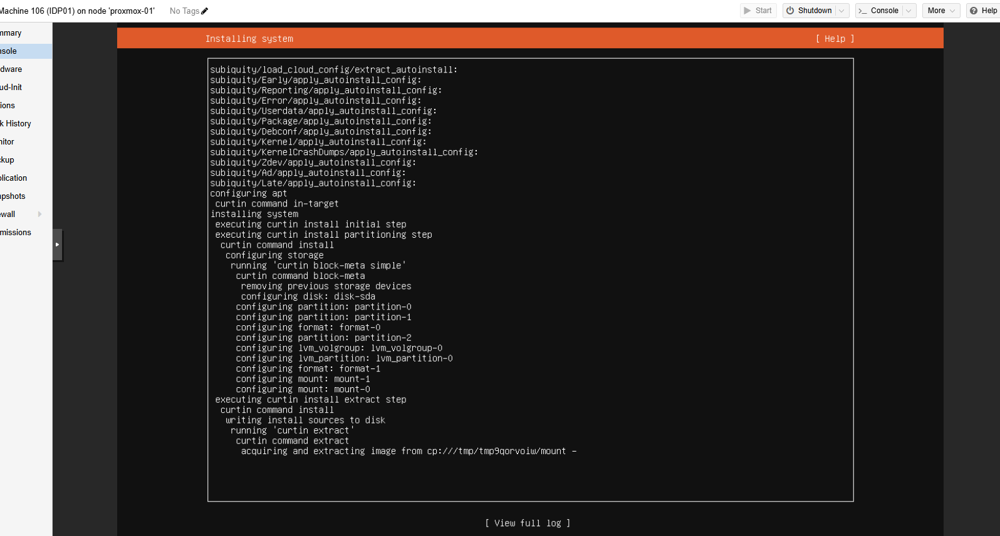
*Figure 23.2: Ubuntu Server 26.04 installing onto the guided LVM layout.*

### 3.2 A static address, set after the fact

The static address was missed in the installer, so the machine came up on DHCP. It was set afterwards in the installer's own netplan file, which matches the interface by MAC address so a renamed device cannot silently lose its configuration.

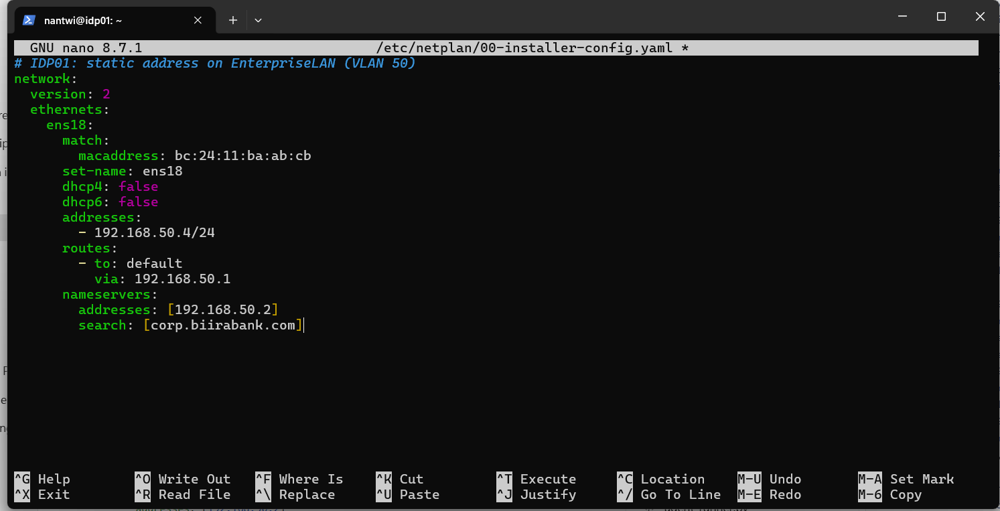
*Figure 23.3: `/etc/netplan/00-installer-config.yaml`: `192.168.50.4/24`, gateway `192.168.50.1`, DNS `DC01` (`192.168.50.2`), search domain `corp.biirabank.com`, DHCP off for both IPv4 and IPv6.*

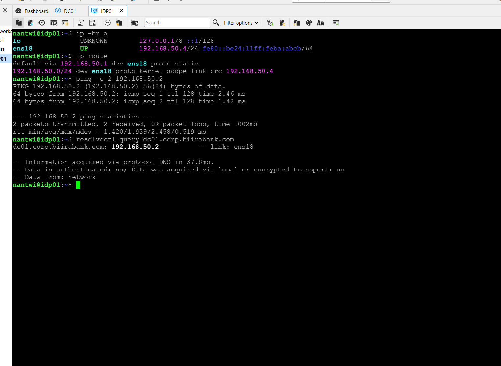
*Figure 23.4: After `netplan apply`: the address and default route are as configured, `DC01` answers, and its name resolves through DC01's own DNS.*

### 3.3 Half the disk

Ubuntu's guided LVM layout gives the root volume only half of the volume group, leaving the rest unallocated. `df -h` showed a 15 GiB root on a 30 GiB group. The volume and the filesystem were grown together, live, with `lvextend -r`.

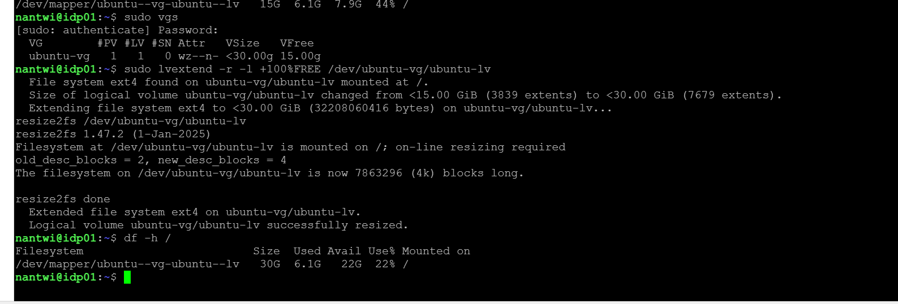
*Figure 23.5: `vgs` shows 15 GiB free; `lvextend -r -l +100%FREE` grows the logical volume and the ext4 filesystem in one step; `df -h /` now reports 30 GiB.*

The machine was then fully updated and rebooted, and `qemu-guest-agent` installed so Proxmox can shut it down cleanly and report its address.

## 4. SSH: keys only

### 4.1 A dedicated key with a passphrase

Administration uses a new ed25519 key pair, `biira-lab-admin`, made for the lab rather than reused from elsewhere. Its private half is protected by a passphrase held in the password manager, so a copied key file alone is useless.

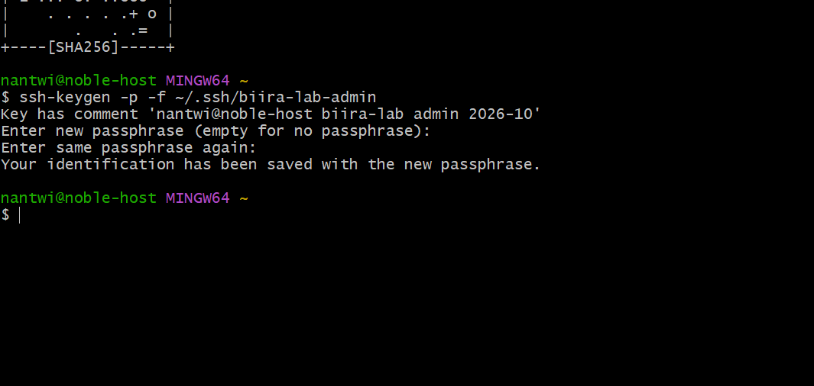
*Figure 23.6: `ssh-keygen -p` adds a passphrase to the key after creation; the key's comment records its purpose and date.*

An `idp01` entry in the laptop's `~/.ssh/config` names the key and sets `IdentitiesOnly yes`, so the client offers only this key instead of every key it holds.

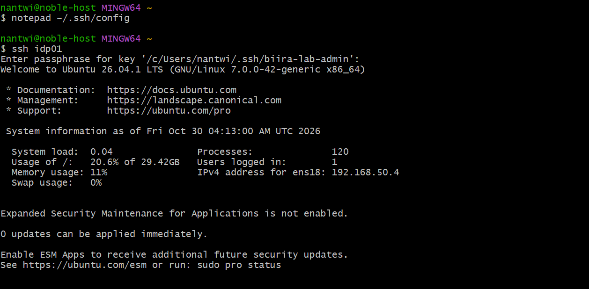
*Figure 23.7: `ssh idp01` asks for the key's passphrase (on the laptop; it never travels) and signs in.*

### 4.2 Checking the server's fingerprint

The first connection from a new client shows the server's host-key fingerprint. It was compared with the value printed on the server itself. Two lessons came from that comparison: a client may show the **ECDSA** fingerprint while the server was asked for its **ED25519** one, so the key types must match before the strings are compared; and look-alike characters (`l` and `I`) mean a fingerprint is read character by character, not at a glance.

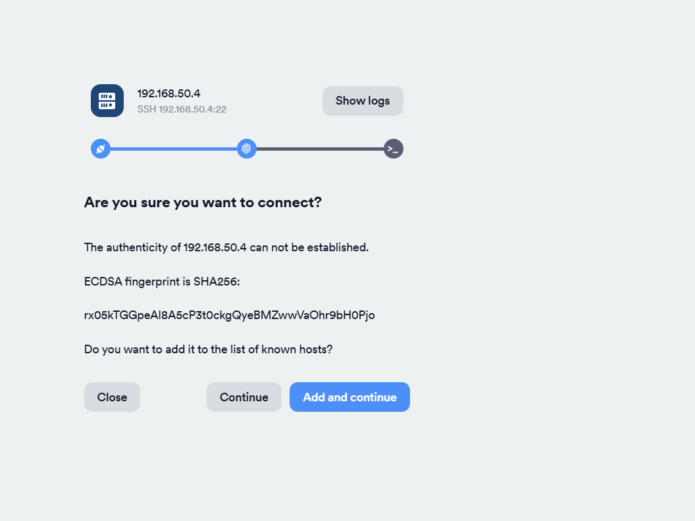
*Figure 23.8: The client's first-connection prompt with the server's ECDSA fingerprint, accepted only after matching the value read on the server.*

### 4.3 Password sign-in switched off

OpenSSH uses the **first** value it reads for each setting, and reads drop-in files in name order. Ubuntu's cloud-init leaves `50-cloud-init.conf` setting `PasswordAuthentication yes`. A file named `00-biira-hardening.conf` is read before it, so its values win.

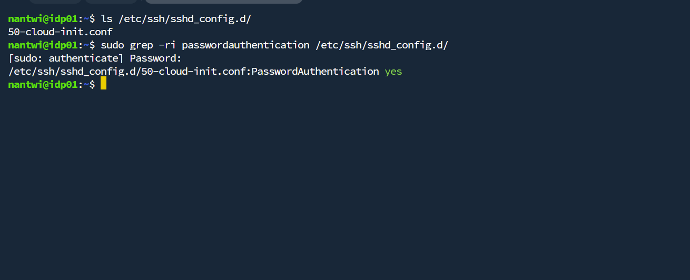
*Figure 23.9: Before: the only drop-in is cloud-init's, and it enables password authentication.*

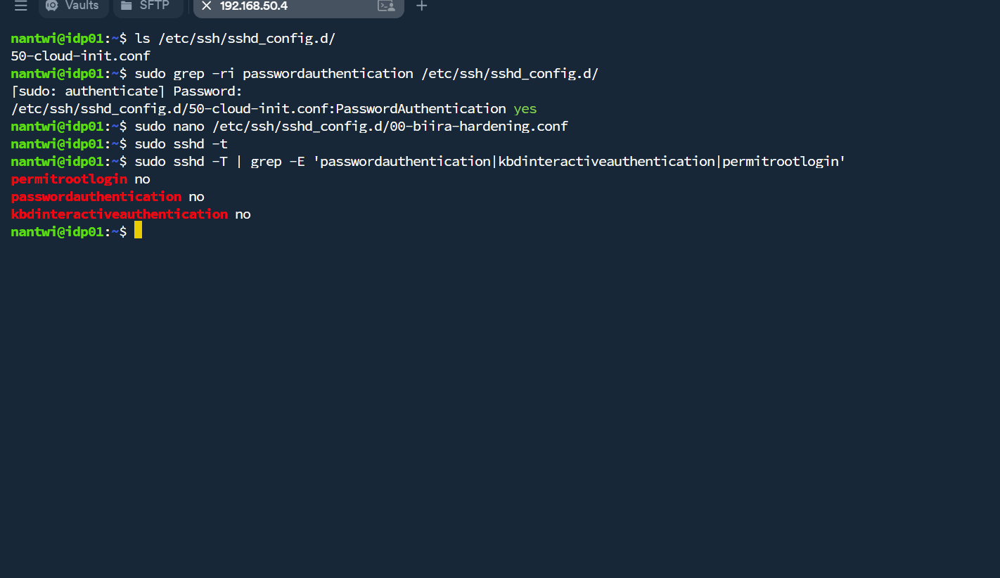
*Figure 23.10: After adding `00-biira-hardening.conf`: `sshd -t` validates the files and `sshd -T` prints the configuration the daemon will actually use: root login, password and keyboard-interactive authentication all `no`.*

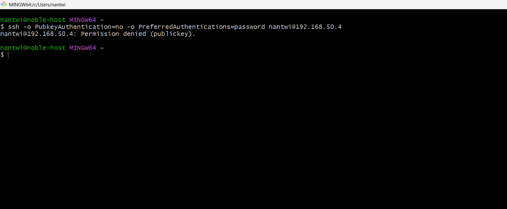
*Figure 23.11: The proof: a client that refuses to offer a key and asks for a password is turned away with `Permission denied (publickey)`. The service was reloaded, not restarted, so the working session stayed open as a way back in.*

## 5. A name, monitoring, and an incident on SIEM01

### 5.1 DNS

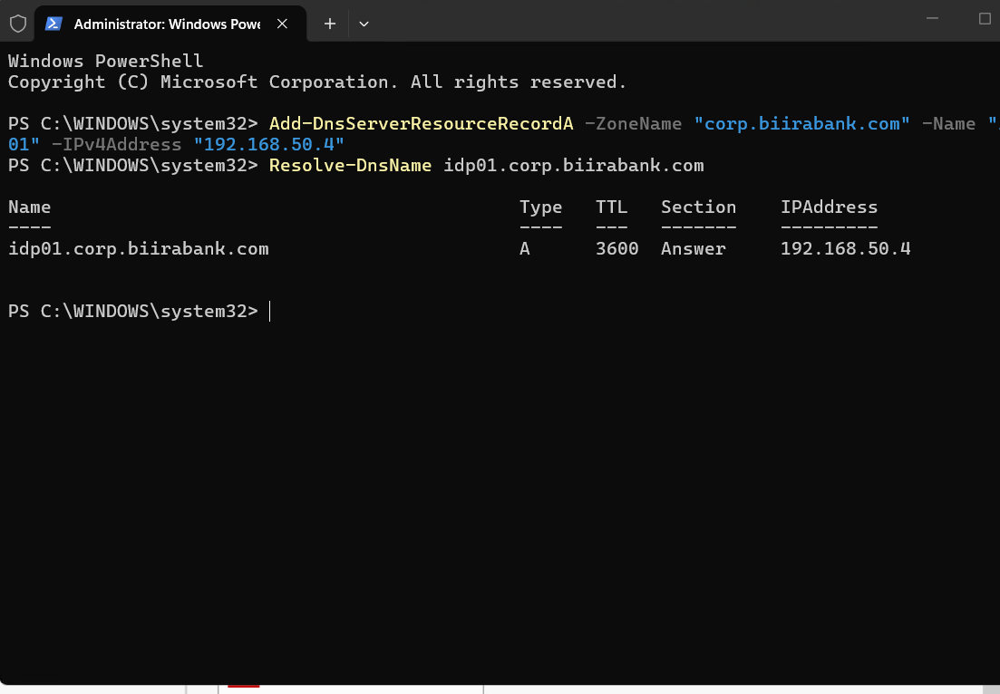
*Figure 23.12: `idp01.corp.biirabank.com` added to the domain's DNS on `DC01` and resolving to `192.168.50.4`. The certificate in section 6 is issued to this name.*

### 5.2 The Wazuh agent

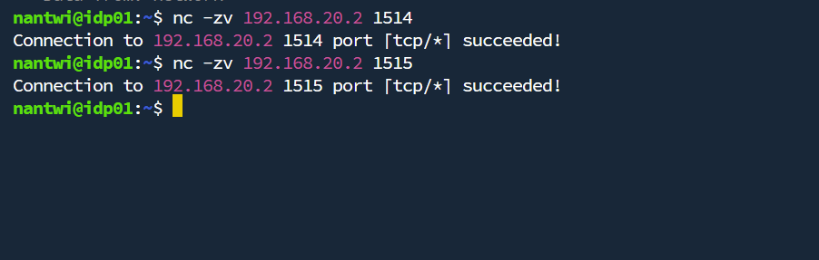
*Figure 23.13: Before installing the agent, the manager's enrolment (1515) and event (1514) ports on `SIEM01` were tested from IDP01. The existing firewall rule is scoped to the EnterpriseLAN subnet as a source, which is what allows it; being on the same VLAN as DC01 does not.*

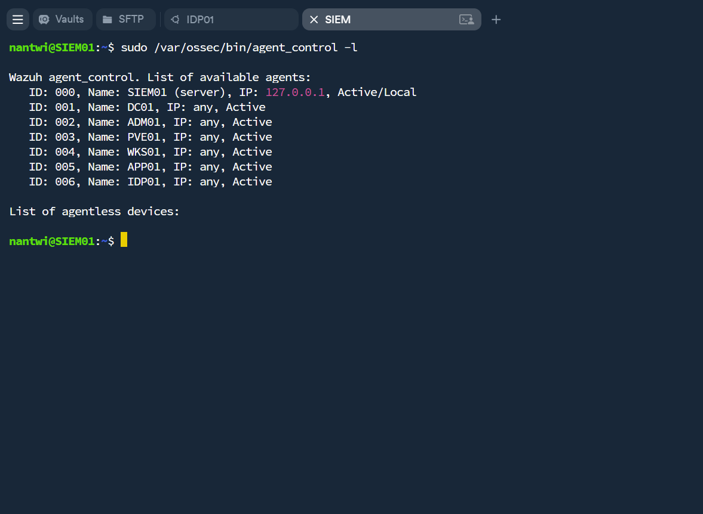
*Figure 23.14: `agent_control -l` on the manager: IDP01 enrolled as agent **006** (Wazuh 4.14.7) and active, beside the five existing agents.*

### 5.3 The dashboard that lost its API

While enrolling the agent, the Wazuh dashboard reported *No API available*.

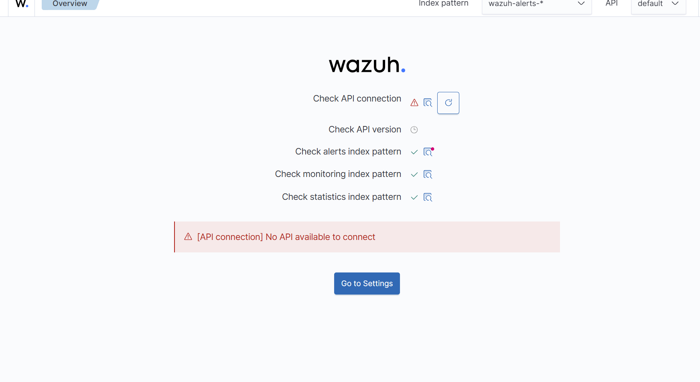
*Figure 23.15: The dashboard could reach its indexer but not the manager's API.*

The cause was on `SIEM01`, not IDP01. After the manager's previous reboot, systemd's start timeout had expired while the manager was still starting, leaving it half-started: some daemons running, others (including the API's dependencies) not. The fix was a systemd drop-in giving the manager the time it needs, `TimeoutStartSec=300` in `/etc/systemd/system/wazuh-manager.service.d/override.conf`, then `systemctl daemon-reload` and a restart. The dashboard returned to green and the agent count was confirmed (Figure 23.14).

## 6. The certificate

### 6.1 How it works

IDP01 needs an HTTPS certificate that every Biira machine trusts, issued by `CA01` (`docs/22`). It is not a domain member, so it cannot enrol itself the way `DC01` did. It uses the manual method instead, and that method is built so the secret half never moves.

*Figure 23.16: The flow. IDP01 makes its key pair and a signing request; only the request (a name and a public key) travels to CA01; CA01 checks who is asking and signs with the root key; the signed certificate (public by design) travels back; IDP01 checks the signature against the Biira root. The private key is created on IDP01 and never copied.*

### 6.2 The request

The request is described by a small OpenSSL config: the name in the subject **and** in the Subject Alternative Name (modern clients ignore the subject and check only the SAN), key usage for a TLS server, and `extendedKeyUsage = serverAuth`. The key is RSA 3072, written without a passphrase (`-nodes`) because a server must start unattended, and protected instead by `chmod 600`.

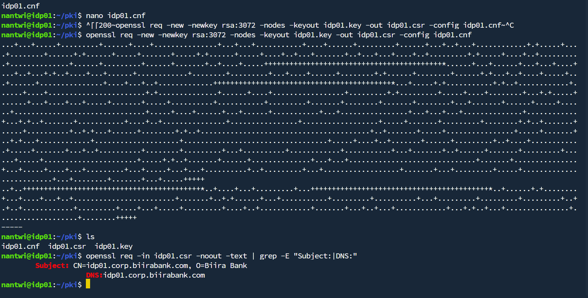
*Figure 23.17: `openssl req -new -newkey rsa:3072 -nodes` produces `idp01.key` and `idp01.csr`; reading the request back shows the subject and the DNS name.*

### 6.3 Signing on CA01, and the first refusal

The request was pasted into a file on CA01 and submitted against the **Web Server** template.

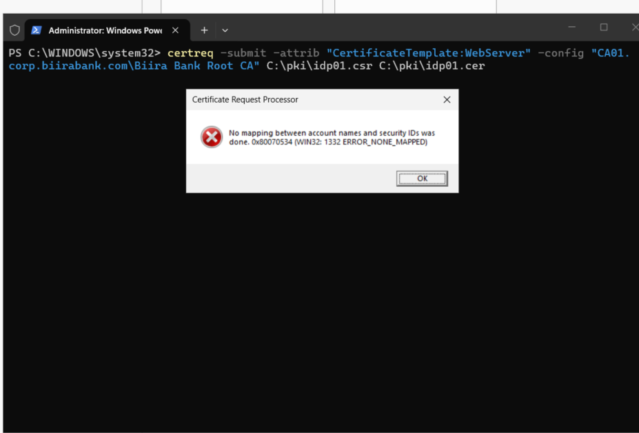
*Figure 23.18: The first attempt failed: `ERROR_NONE_MAPPED`.*

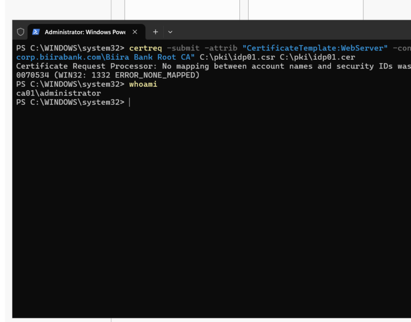
*Figure 23.19: The cause: the session was signed in as `ca01\administrator`, the machine's local account. An Enterprise CA checks each request against the template's permission list, which holds domain accounts. A local account cannot be looked up in the domain, so the request could not be mapped to anyone. `Test-ComputerSecureChannel` returned `True`, ruling out a broken trust between CA01 and DC01.*

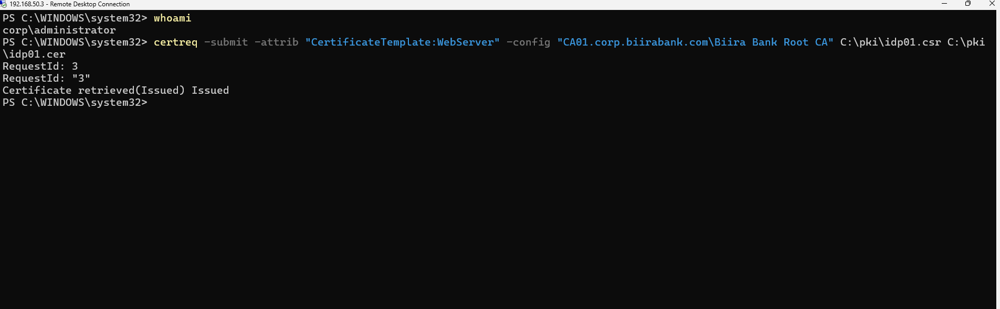
*Figure 23.20: Signed in as `CORP\Administrator`, the same command returns **Request ID 3, Issued**.*

### 6.4 Checking it on IDP01

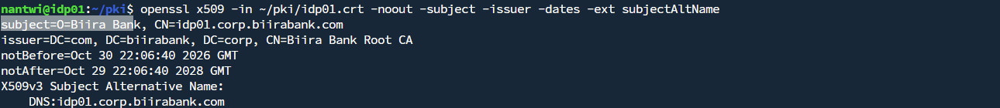
*Figure 23.21: Subject and SAN `idp01.corp.biirabank.com`, issuer `Biira Bank Root CA`, valid 30 October 2026 to 29 October 2028 (the template's two years).*

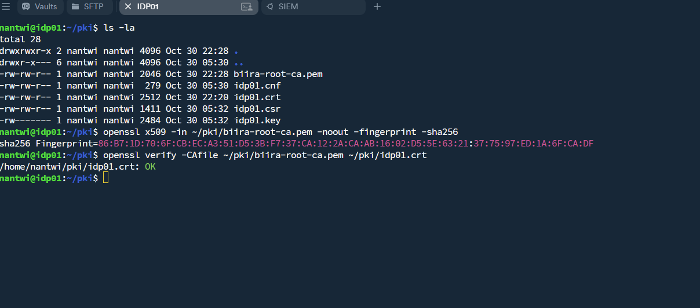
*Figure 23.22: The root certificate copied to IDP01 is first matched against the fingerprint published in `docs/22` (`86:B7:1D:70 ... 1A:6F:CA:DF`), and only then used: `openssl verify` confirms CA01 signed IDP01's certificate.*

### 6.5 Trusting the root system-wide

Section 6.4 trusted the root for one command. The root was then added to Ubuntu's trust store, so every program on IDP01 recognises certificates CA01 issues, including the one `DC01` presents for LDAPS.

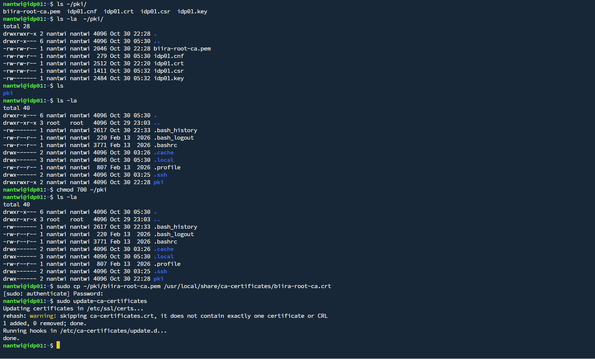
*Figure 23.23: The working folder closed to other users (`chmod 700 ~/pki`), the root copied to `/usr/local/share/ca-certificates/` (which requires the `.crt` extension), and `update-ca-certificates` reporting `1 added`.*

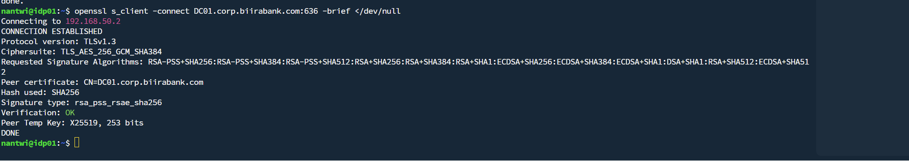
*Figure 23.24: With no root passed by hand, `openssl s_client` to `DC01.corp.biirabank.com:636` negotiates TLS 1.3, shows DC01's certificate, and reports `Verification: OK`.*

## 7. Keycloak in Docker Compose

### 7.1 Docker, and who may use it

Docker came from Ubuntu's own packages (`docker.io`, `docker-compose-v2`) rather than a third-party repository: one less software source to trust, patched by the normal update cycle.

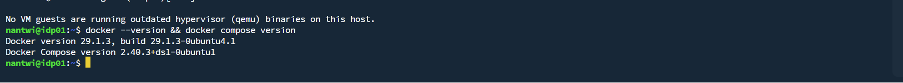
*Figure 23.25: Docker 29.1.3 and Compose 2.40.3.*

The administrator account was deliberately **not** added to the `docker` group. Membership of that group is equivalent to root without a password, so on a Tier 0 host every Docker command goes through `sudo`, and is logged as such.

### 7.2 The folder and its secrets

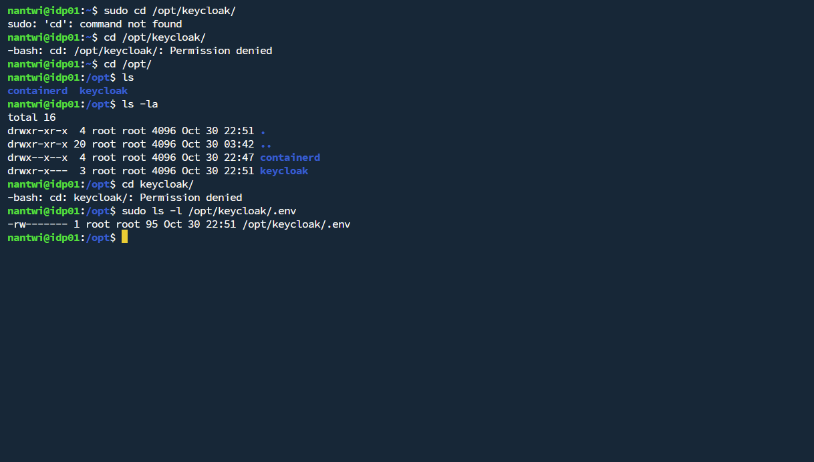
*Figure 23.26: `/opt/keycloak` is `750` root-only (a normal user cannot even enter it), and `.env`, holding the database password and the bootstrap administrator's password, is `600` root. Both passwords were generated on the server with `openssl rand` and never displayed. `sudo cd` fails because `cd` is a shell built-in, not a program.*

The certificate and key were copied to `/opt/keycloak/certs` (folder `700`, key `600`), owned by user 1000, the unprivileged user Keycloak runs as inside its container.

### 7.3 Pinned versions

Image tags such as `postgres:18` move. The tag was resolved to its exact release before writing the recipe.

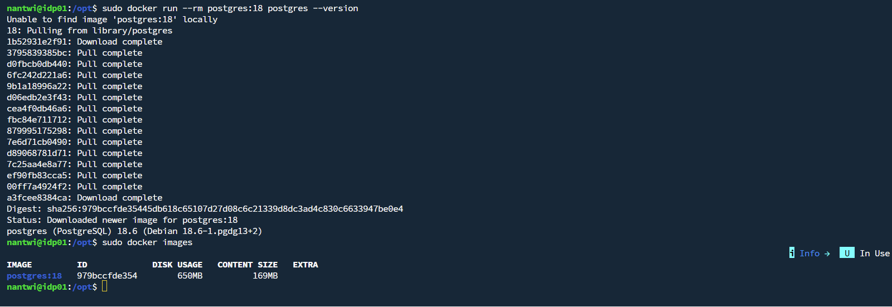
*Figure 23.27: The `18` tag resolved to **PostgreSQL 18.6**, within the range Keycloak 26.8 supports, and was pinned. The image digest printed during the pull is the image's fingerprint. Keycloak itself is pinned to `quay.io/keycloak/keycloak:26.8.1`, the latest release at build time.*

### 7.4 The recipe

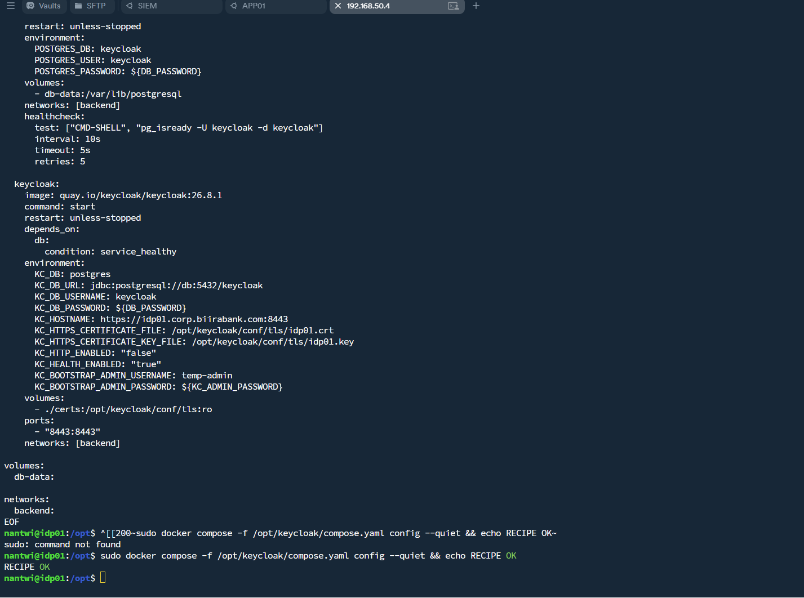
*Figure 23.28: The compose file: the database has **no `ports:`** entry, a health check, and Keycloak waits for it to be healthy; Keycloak runs `start` (production mode), HTTP disabled, hostname set, certificate and key mounted read-only, and only 8443 published. Passwords appear only as `${VARIABLE}` references to `.env`. `docker compose config --quiet` validates it; without `--quiet` the command prints the recipe with the passwords filled in.*

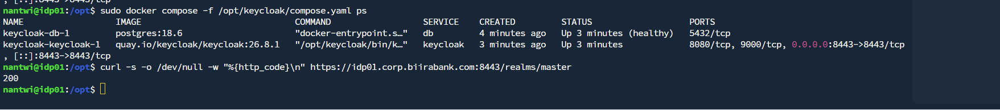
*Figure 23.29: Both containers up, the database healthy, only `0.0.0.0:8443` published (5432, 8080 and 9000 are listed but reachable only inside the container network), and `curl` to `https://idp01.corp.biirabank.com:8443/realms/master` returning `200`. That single request proves the name resolves, the certificate is trusted by the system store from section 6.5, and Keycloak answers.*

### 7.5 From the administrator's laptop

The laptop is not domain-joined. It was given the name in its hosts file, and the Biira root was imported into the **current user's** trusted roots only, not the whole machine's. Windows shows exactly the trust decision being made:

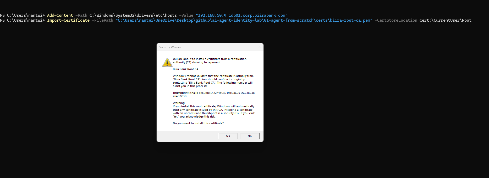
*Figure 23.30: Windows names the root and its SHA-1 thumbprint and warns that every certificate it issues will be trusted. The file was the one whose fingerprint was verified in Figure 23.22. The trade-off is explicit: this browser now believes anything CA01 signs, which is one more reason CA01 is held as Tier 0.*

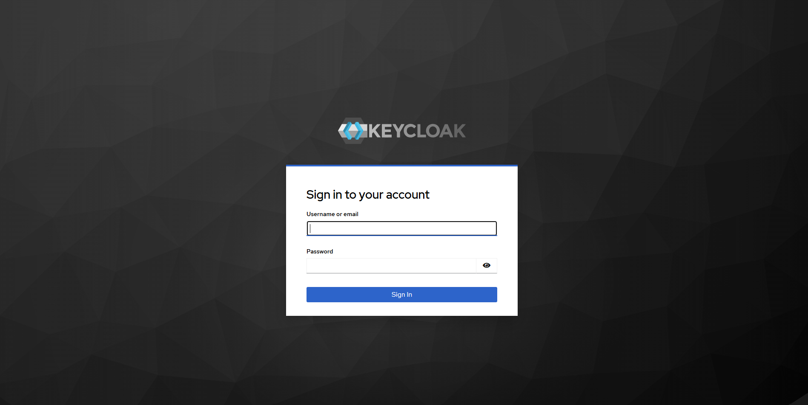
*Figure 23.31: The administration console's sign-in page over HTTPS with no certificate warning.*

## 8. The first administrator

Keycloak creates a **temporary** administrator from the bootstrap variables and says so on every page.

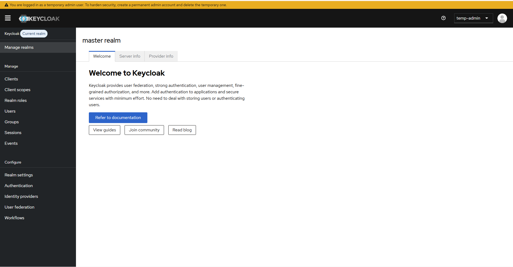
*Figure 23.32: Keycloak's own banner: create a permanent administrator and delete the temporary one.*

A named administrator, `noble-admin`, was created in `master` with the `admin` role, a password from the password manager, and **Configure OTP** as a required action, so the account had a second factor from its first sign-in.

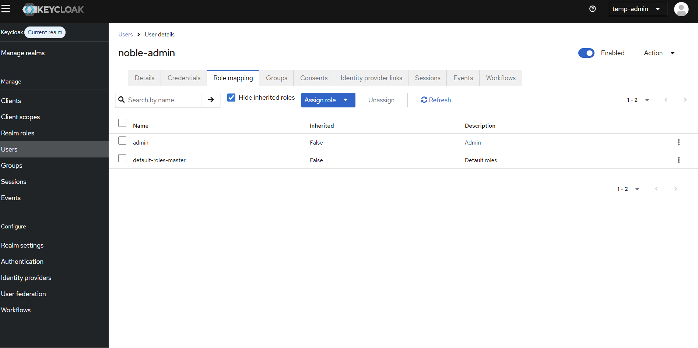
*Figure 23.33: `noble-admin` holds the `admin` realm role.*

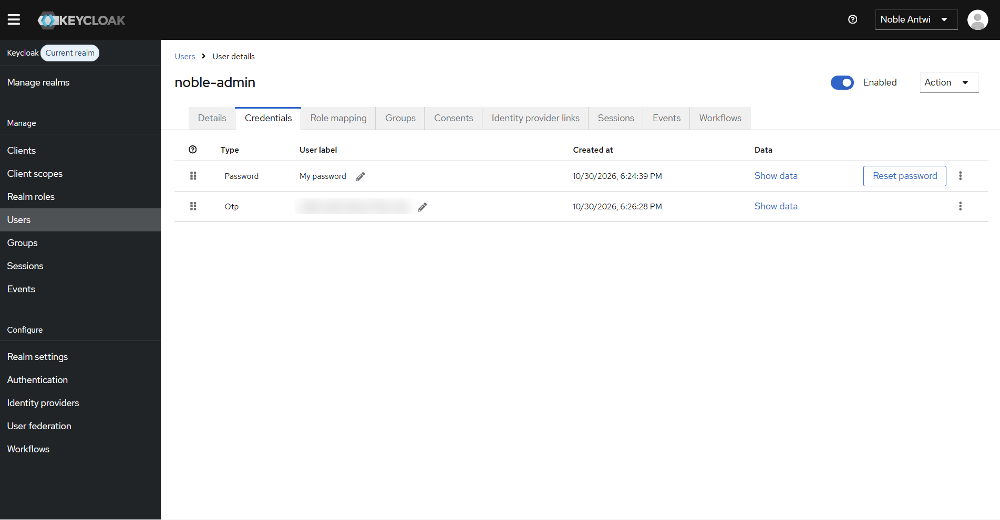
*Figure 23.34: Two credentials: a password and an authenticator app (device label blurred).*

An OTP enrolment page shows a QR code that **is** the shared secret: anyone with an image of it can generate valid codes. A screenshot of the first enrolment page was taken by mistake, so that secret was treated as burned: the page was reloaded (Keycloak generates a new secret on each load) and the new code enrolled. Screenshots are taken after enrolment, never during.

Removing the temporary administrator took two steps: the account in the console, and its password from the server.

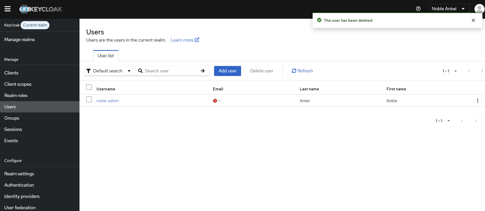
*Figure 23.35: The temporary account deleted; `noble-admin` is the only administrator. No email address is set on it: email-based reset is a recovery path attackers abuse, and recovery for this account is from the server itself, which first requires the SSH key.*

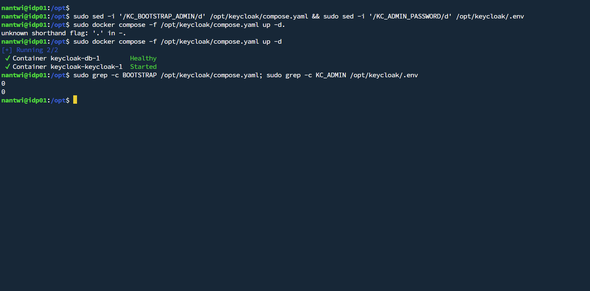
*Figure 23.36: The bootstrap lines removed from `compose.yaml` and `.env` with `sed`, Keycloak recreated (the database untouched), and `grep -c` printing `0` for both files. A stray full stop typed after `up -d` produced "unknown shorthand flag"; rerun without it.*

## 9. Sign-in records, and a reboot

Keycloak keeps no record of sign-ins or administrative changes by default. Both were switched on: **user events** (sign-ins, failed passwords, failed codes) and **admin events** (every change an administrator makes), with "include representation" off so whole user records are not copied into the log. Events are stored per realm, so this was done in `master` and again in `biira`.

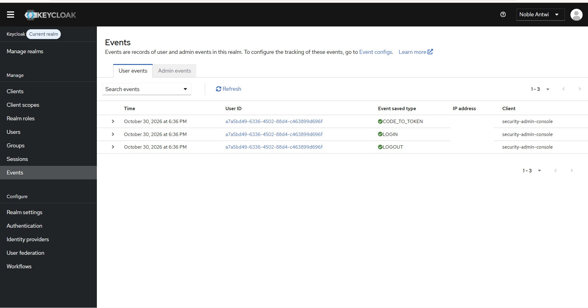
*Figure 23.37: A sign-out and sign-in recorded as `LOGOUT`, `LOGIN` and `CODE_TO_TOKEN`. Users are logged by their permanent ID, not their name, so renaming an account cannot hide its history.*

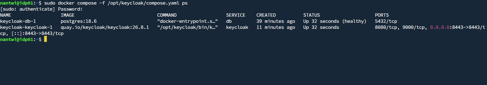
*Figure 23.38: After `sudo reboot`, both containers are back without intervention, the database healthy, because of `restart: unless-stopped` and Docker starting at boot.*

## 10. Connecting Active Directory

### 10.1 Keycloak's own account

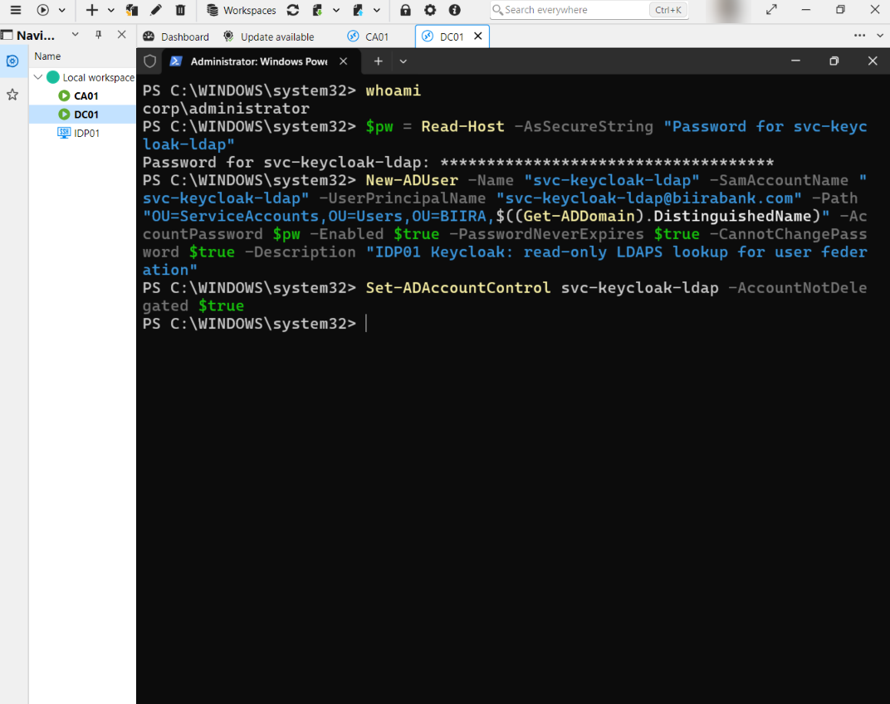
*Figure 23.39: `svc-keycloak-ldap` created on `DC01` in `OU=ServiceAccounts` with no groups beyond Domain Users (which can already read the directory), marked as unable to be delegated, its password typed with `Read-Host -AsSecureString` so it was neither shown nor kept in history.*

### 10.2 The container's own trust store

Keycloak runs inside a container with its own trust store, which does not see IDP01's. The Biira root was mounted into it and named with `KC_TRUSTSTORE_PATHS`.

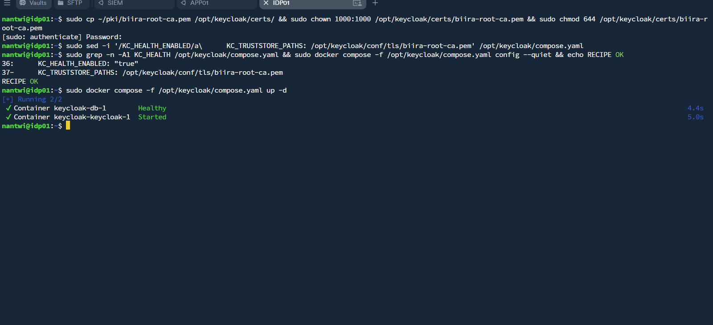
*Figure 23.40: The root copied beside Keycloak's certificate, one line inserted into the recipe at the same indentation as its neighbours, the recipe validated, and Keycloak restarted.*

The Biira root is now trusted in three places, each its own list: IDP01's system store (section 6.5), the administrator's browser (section 7.5), and Keycloak's container (this section).

### 10.3 A realm for staff

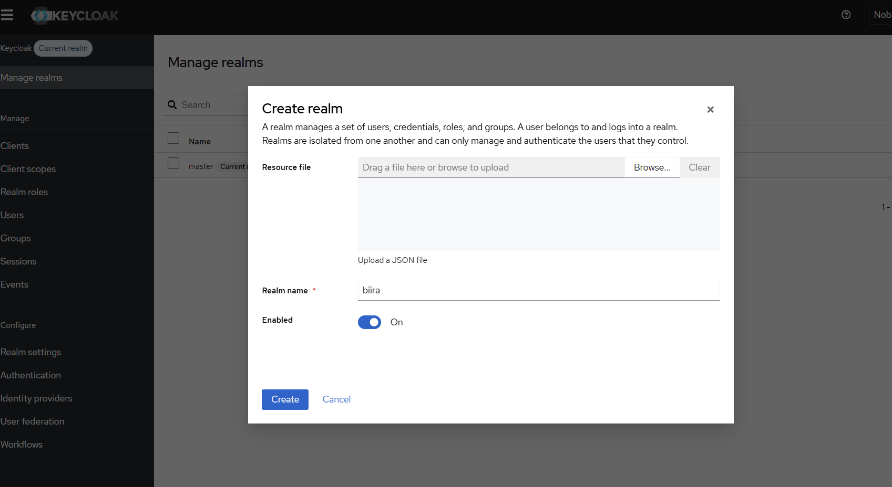
*Figure 23.41: The `biira` realm created for Biira Bank's employees. Everything below happens in it, never in `master`.*

### 10.4 The provider

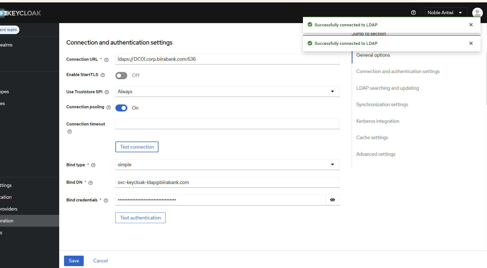
*Figure 23.42: Connection URL `ldaps://DC01.corp.biirabank.com:636` (the name, not the address, because the name is what DC01's certificate carries), the truststore set to *Always*, a simple bind as `svc-keycloak-ldap@biirabank.com`. **Test connection** proves Keycloak reached DC01 and trusted its certificate; **Test authentication** proves the account's credentials.*

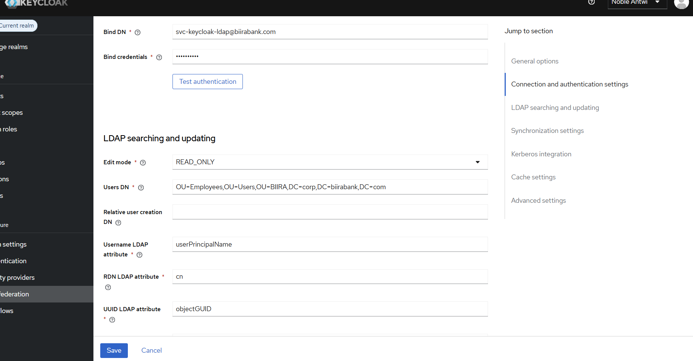
*Figure 23.43: Edit mode **READ_ONLY**; Users DN the Employees OU, so administrative and service accounts cannot sign in through Keycloak; the username taken from **`userPrincipalName`**, so people sign in as `name@biirabank.com` exactly as they do to Windows; `objectGUID` as the permanent identifier.*

The remaining settings: search scope **Subtree** (employees sit in department OUs), **import users** on (Keycloak keeps a card for each person, never the password, so it can attach its own data such as an OTP device), **sync registrations** off (nobody can create an AD account by signing up), **remove invalid users** on (someone deleted from AD is forgotten), Kerberos off, and periodic synchronisation off for now: people are copied at their first sign-in or on demand.

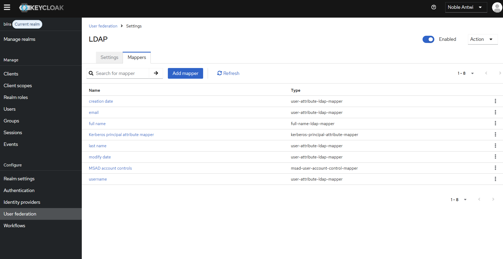
*Figure 23.44: The mappers created for the Active Directory vendor. `MSAD account controls` reads `userAccountControl`, so an account disabled or locked in AD is disabled in Keycloak.*

### 10.5 Zero users, and the space that caused it

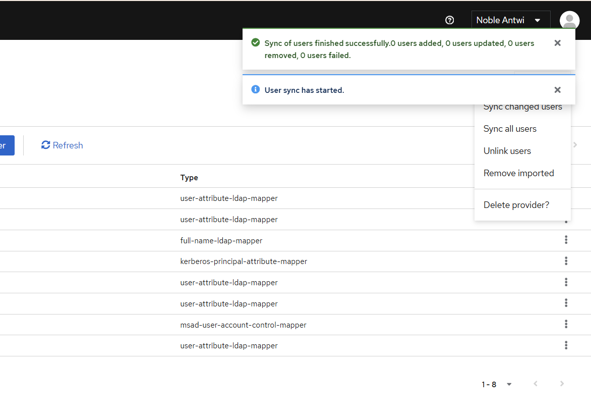
*Figure 23.45: The first synchronisation completed without errors and imported nobody.*

The directory was fine: the Employees OU held 25 people, each with a UPN, in department sub-OUs. Keycloak's log shows the configuration it actually saved:

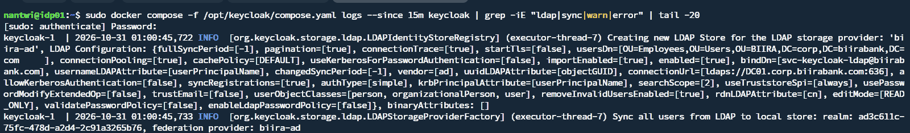
*Figure 23.46: `usersDn=[OU=Employees,...,DC=com     ]`: spaces after `DC=com`, carried in when the value was pasted. To the directory that is a different, non-existent name, so the search found no one. The same log showed connection tracing switched on and sync registrations on; both were turned off.*

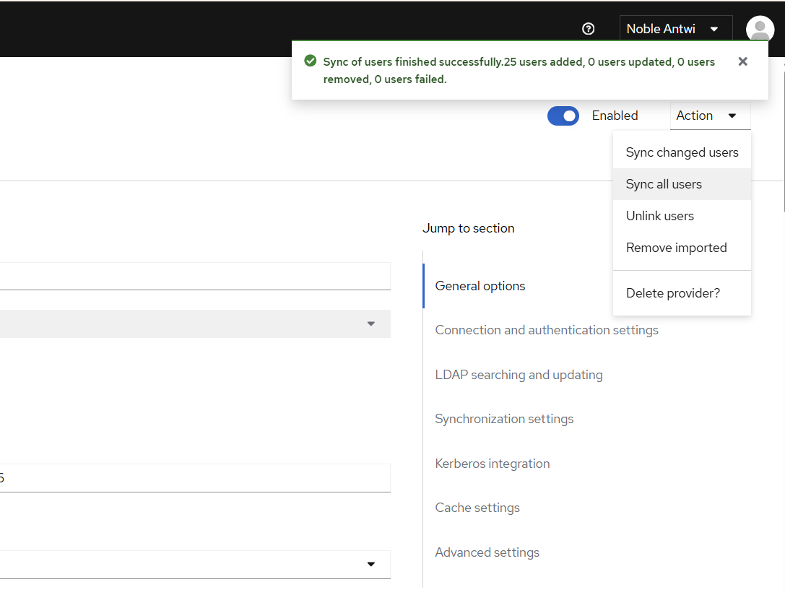
*Figure 23.47: With the spaces removed: **25 users added, 0 failed**.*

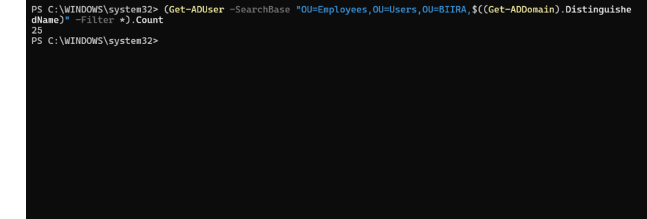
*Figure 23.48: The same count from the directory: 25 accounts under the Employees OU.*

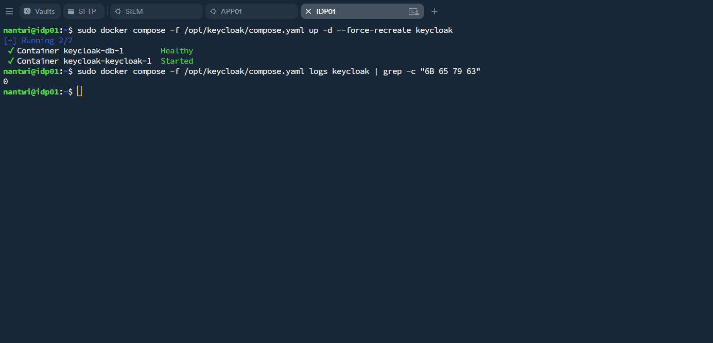
*Figure 23.49: Connection tracing writes the raw directory conversation into the container log. With it off, the container was recreated, which discards its old log, and a search for the trace's byte pattern returned `0`.*

### 10.6 An employee signs in

A test employee, Emily Davis, was given a new password on DC01 with "must change password at next logon" cleared: in read-only mode Keycloak cannot pass a password change back to AD.

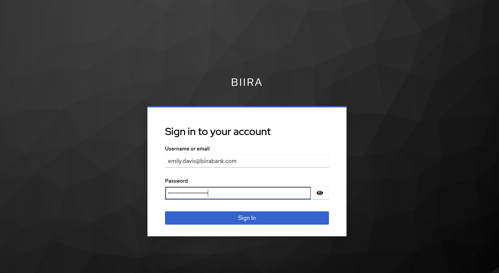
*Figure 23.50: The `biira` realm's sign-in page (in a private window) with her UPN.*

*Figure 23.51: Signed in. The account console at `idp01.corp.biirabank.com:8443/realms/biira/account` shows her details, read from Active Directory and greyed out because Keycloak cannot change them.*

That sign-in exercised the whole chain: the browser trusted IDP01's certificate, Keycloak found her with its read-only account over LDAPS, and DC01 checked her password. Keycloak stored none of it.

## 11. What went wrong

| What happened | Cause | Lesson |
|---|---|---|
| Disk on the wrong storage, generic CPU type | Wizard defaults accepted on the earlier tabs | Read the confirm page before *Finish* |
| Root volume half the disk | Ubuntu's guided LVM default | `df -h` on day one; `lvextend -r` fixes it live |
| Static address missed at install | Skipped installer screen | Netplan afterwards, matched by MAC |
| Wazuh API unavailable | Manager half-started after a start timeout | `TimeoutStartSec` override on SIEM01 |
| `ERROR_NONE_MAPPED` from the CA | Signed in with a local account | `whoami` before anything identity-based |
| OTP QR code captured | Screenshot during enrolment | Treat as burned, re-enrol, screenshot after |
| Sync imported 0 users | Trailing spaces in a pasted DN | Read the saved configuration in the log, not the form |
| Connection trace on | Left on in the provider form | Off, and the old log discarded |

## 12. Control mapping

| Control | How this chapter satisfies it |
|---|---|
| NIST SP 800-53 `IA-2(1)` | Multi-factor authentication for the privileged Keycloak administrator from first sign-in |
| NIST SP 800-53 `IA-5` | Authenticator management: SSH keys with passphrases, generated service secrets never displayed, the bootstrap password removed, OTP secrets protected |
| NIST SP 800-53 `AC-2` | Accounts managed in one place: AD remains the source of truth, deletion and disablement propagate, a dedicated service account for the integration |
| NIST SP 800-53 `AC-6` | Least privilege: read-only federation scoped to one OU, no `docker` group, root-only secrets, unprivileged container user, staff realm separate from `master` |
| NIST SP 800-53 `SC-8` | HTTPS only to Keycloak; LDAPS (TLS 1.3) to the directory |
| NIST SP 800-53 `SC-12`, `SC-17` | The private key generated on IDP01 and never moved; the certificate issued by the organisation's CA; the root distributed by verified fingerprint |
| NIST SP 800-53 `SC-23` | Session authenticity: every client (browser, IDP01, Keycloak's container) validates the certificate and name it connects to |
| NIST SP 800-53 `AU-2`, `AU-12` | Keycloak user and admin events recorded in both realms; the host reports to Wazuh as agent 006 |
| NIST SP 800-53 `CM-2`, `CM-6` | A pinned, version-controlled baseline (Compose recipe, exact image versions) and hardened SSH settings verified from the effective configuration |
| NIST SP 800-53 `CM-7` | Least functionality: only 8443 published, plain HTTP and password SSH disabled, the database unreachable from the network |
| NIST SP 800-53 `CP-10` | Recovery: containers restart on boot, proven by reboot; the whole service rebuilds from one file |
| CIS Controls v8 `5.4`, `6.5` | Administrative privileges restricted to dedicated accounts; MFA for administrative access |
| CIS Controls v8 `6.7` | Centralised access control through an identity provider |
| CIS Controls v8 `12.x` | Network infrastructure: the IdP placed in the identity tier, its database on a private network |

## 13. Scope and next steps

Done in this chapter: the machine, its hardening and monitoring, its certificate, Keycloak with its database, a protected administrator, event recording, and AD federation proven with a real sign-in.

Next:

1. **The first machine client.** The AI agent from `ai-agent-identity-lab` gets a Keycloak client using the client-credentials grant, so a program proves its identity with short-lived tokens instead of a stored password.
2. **Applications behind Keycloak**, each with a scoped pfSense rule to 8443 added when it is connected, and periodic synchronisation switched on (changed users every 15 minutes, a full pass daily) once applications need to see people before they first sign in.
3. **Keycloak events into Wazuh**, so sign-in failures on the IdP are detected alongside the domain controller's.
4. **Windows integrated sign-in (Kerberos)** for domain-joined workstations, tested from `WKS01`.
5. **Self-service password reset with write-back** as its own lesson, with delegation limited to the Employees OU and monitored.
